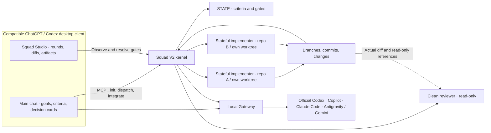

# MyCodex

[](LICENSE)
[](https://nodejs.org/)
[](https://github.com/funkdog/ccodex-release/releases/tag/mycodex-adapters-v0.1.0-rc.4)

[中文](README.md) · English

**Set direction in one conversation. Ship in parallel from separate worktrees.**

## What is MyCodex?

MyCodex adds a local multi-engine gateway and multi-agent collaboration to compatible **official Codex / ChatGPT desktop clients**. You work in the familiar desktop window with its native chat stream, project file tree, integrated terminal, and controls.

- **Multi-Engine Gateway.** Connect official Codex, GitHub Copilot (API / CLI), Claude Code, and supported Antigravity / Gemini runtimes from one window using your own accounts and subscriptions. Choose a configured engine and model when starting a new chat. In an existing chat, switch among compatible models from the same engine and model source. A Squad can use different configured models by role, for example one for implementation and another for an independent review. [Engine and model selection rules](docs/architecture/0031-model-sources-and-handoff.zh-CN.md)
- **MyCodex Squad in the native split pane.** Use one main conversation on the left to set direction, agree on acceptance criteria, and make decisions. Keep `Squad Studio` docked on the right to inspect member worktrees, branches, rounds, Git diffs, and read-only artifact previews. Members can pick up where they left off or start fresh for a read-only review. Move a persistent member to the sidebar when you want to talk with it directly.


## Squad Design Philosophy: Beyond the Group Chat

Researchers at UC Berkeley and their collaborators used MAST to analyze 1,642 execution traces, documenting failures in task definition, coordination, and verification. Anthropic's Research system gives independently explorable tasks their own context windows. Cognition's Devin team describes how code edits embed implicit decisions that can clash across parallel writers. They also report using an independent reviewer that starts from the diff. [MAST paper](https://openreview.net/attachment?id=fAjbYBmonr&name=pdf) · [Anthropic's Research system](https://www.anthropic.com/research/multi-agent-research-system) · [Cognition's multi-agent experiments](https://cognition.com/blog/multi-agents-working)

1. **Split work at context boundaries and keep memory local to the module.** Give modules that require extensive code reading and test runs their own slots. A `stateful` implementer continues the same conversation across rounds, retaining what it learned about interfaces, constraints, and earlier investigations. Shared goals and agreements stay in the main conversation.
2. **Review from a fresh, read-only context.** A `clean` + `readOnly` reviewer starts a new conversation with the acceptance criteria, actual diff, and relevant original material. The implementer's conversation history stays in its own slot, and the reviewer can trace findings back to code and tests.
3. **Isolate worktrees across repositories and hand off material by reference.** Writing slots can bind to different repositories and use their own Git worktrees. `touches` declares write scope and `forbid` carries prohibited paths across rounds by default. Pass original material through `inputs` and consult sibling worktrees as read-only references. The kernel records branches, commits, and changes from Git and checks write boundaries before integration.
4. **Give `STATE` one writer and let the kernel check execution state.** The main conversation maintains the live plan with plain-language outcomes and falsifiable technical criteria. `quiescent` means execution has settled. A receipt marked `escalate` requests a human decision. The main conversation assesses acceptance from the evidence, and people decide the gates that require their judgment.
5. **Expose assumptions at handoff and interrupt for decisions.** Members include `Assumptions & Trade-offs` in their receipts. The main conversation can use a technical review card to highlight design, performance, and risk choices. `Needs You` takes up zero space when clear. Inline cards and chat replies update the same gate state.

## Architecture



### Squad MCP tools

The table uses the registered MCP names. A host may render the dot as an underscore. The main conversation uses the control tools. Members receive scoped briefs and references to the original material.

| Tool | Responsibility |
| --- | --- |
| `mycodex.squad_init` | Initialize or resume the Squad for the main conversation and return its Studio entry. |
| `mycodex.squad_state` | Use the current `expectedRevision` to update the plan, record acceptance, or resolve a gate. |
| `mycodex.squad_dispatch` | Dispatch a round asynchronously with a context mode, repository, write boundaries, and source references. |
| `mycodex.squad_status` | Read the Studio snapshot for activity, delivery receipts, and acceptance status. |
| `mycodex.show_squad_card` | Present a gate or a curated technical review in the conversation. The presentation is read-only. |
| `mycodex.squad_integrate` | Merge a quiescent role worktree after checking its write boundaries and record acceptance for the round. |
| `mycodex.squad_close` | Close a standing Squad at the user's request, preserving chats and optionally promoting persistent members. |

[Tool registration and parameter schemas](gateway/spine/squad-commands.mts)

## Quick Start

### Build and verify from source

Install Git, Node.js 24 or later, and npm. These commands use a macOS or Linux shell. On Windows, use the same npm scripts and `tools/Invoke-HeavyTask.ps1` for manual heavy tasks.

```bash
git clone https://github.com/funkdog/ccodex-release.git
cd ccodex-release
npm ci
npm run typecheck
npm run build
npm run check:generated
bash tools/Invoke-HeavyTask.sh node --test tests/squad-protocol-test.mjs tests/squad-lifecycle-test.mjs
```

After building on macOS, you can launch a compatible official desktop client against your local source build to enable the full gateway and Squad Studio (see [`platforms/macos/`](platforms/macos/) and [`docs/DEVELOPMENT.zh-CN.md`](docs/DEVELOPMENT.zh-CN.md)). Browser tests need Playwright and a Chromium browser; see the [contribution guide](CONTRIBUTING.md) for source entry points, isolated test setup, and broader checks.

### Try the macOS Adapters prerelease

[Download MyCodex Adapters 0.1.0-rc.4](https://github.com/funkdog/ccodex-release/releases/tag/mycodex-adapters-v0.1.0-rc.4). This candidate is for **macOS Apple Silicon (ARM64)**. Live desktop acceptance is pending. Verify the platform archive's SHA-256, extract it to a directory you will keep, and run `Install.command` and `Diagnose.command`. Quit the existing desktop client normally before using `Start.command`.

- [macOS installation and compatible host versions](docs/ADAPTERS-MACOS.zh-CN.md) (Chinese)
- [Connect your own GitHub Copilot account and select a model](docs/CODEX-COPILOT-SETUP.zh-CN.md) (Chinese)
- [RC.4 release and verification record](docs/releases/mycodex-adapters-0.1.0-rc.4.md) · [RC.3 release record](docs/releases/mycodex-adapters-0.1.0.md) (Chinese)

`main` contains the Squad V2 source. RC.4 is an earlier frozen Adapters snapshot with Squad disabled.

## Repository Guide

| Path | Contents |
| --- | --- |
| [`gateway/`](gateway/) | App Server routing, session protocol, and engine adapters |
| [`gateway/spine/`](gateway/spine/) | Squad V2 kernel, MCP, state, and worktree checks |
| [`bridge/`](bridge/) | Response translation, desktop host integration, and [Squad Studio and inline cards](bridge/diy/) |
| [`tests/`](tests/) · [`tools/`](tools/) | Regression tests, build tools, source audit, and verification |
| [`docs/`](docs/) · [`release/`](release/) | Design notes, user guides, and release provenance |

- [ADR 0034 · Squad V2 architecture](docs/architecture/0034-squad-v2-architecture.zh-CN.md) (Chinese)
- [ADR 0035 · Squad V2 retrospective](docs/architecture/0035-squad-v2-retrospective-and-closeout.zh-CN.md) (Chinese)
- [Squad Studio visual specification](docs/design/squad-visual-spec.md) · [Engine and native display contracts](docs/architecture/0032-heterogeneous-model-and-display-standard.zh-CN.md) (Chinese)

## Acknowledgments

- Thanks to **troupe** for its single-orchestrator workflow, up-front approval of acceptance criteria, per-role Git worktrees, and independent branch review before integration. [troupe](https://github.com/hitianqi/troupe)
- Thanks to **bothouse** for showing how to team up local CLIs such as Claude Code, Codex, and Gemini, preserve the user's original wording in handoffs, and add a second check from a clean context. [bothouse](https://github.com/zuiho-kai/bothouse)
- Thanks to the UC Berkeley MAST researchers, Anthropic's engineering team, and Cognition's Devin team for publishing their findings on multi-agent failures, context separation, and independent review. [MAST](https://openreview.net/attachment?id=fAjbYBmonr&name=pdf) · [Anthropic](https://www.anthropic.com/research/multi-agent-research-system) · [Cognition](https://cognition.com/blog/multi-agents-working)

## License

The first-party gateway, bridge, and Squad source are available under the [MIT License](LICENSE). Third-party components retain their own terms. Users manage third-party private runtime binaries and personal credentials separately from this source repository.
