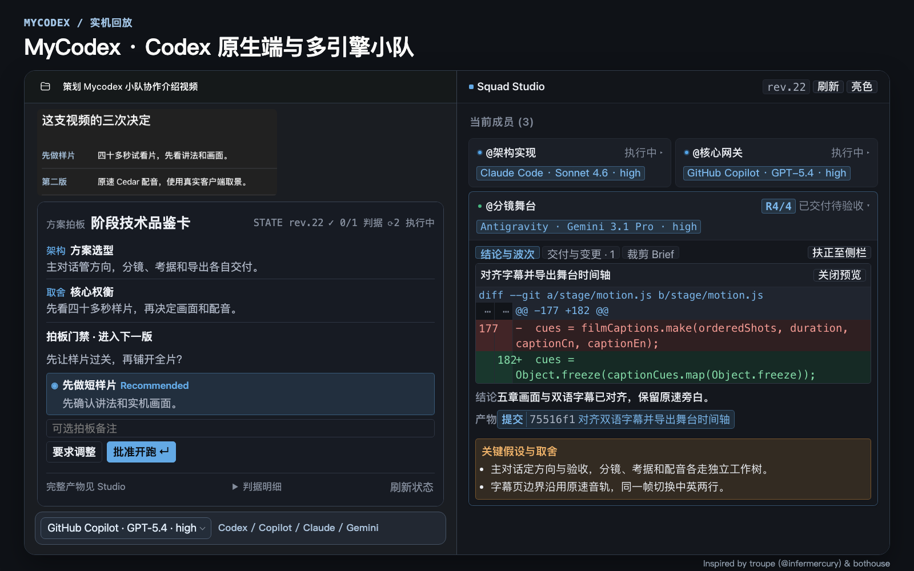
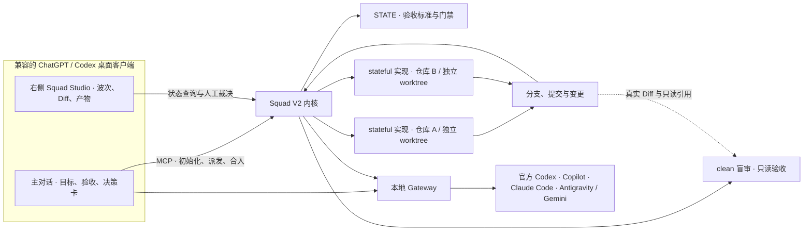

# MyCodex

[](LICENSE)
[](https://nodejs.org/)
[](https://github.com/funkdog/ccodex-release/releases/tag/mycodex-v0.2.0-rc.1)
[![LINUX DO](https://img.shields.io/badge/LINUX-DO-FFB003.svg?logo=)](https://linux.do)

中文 · [English](README.en.md)

**一个主对话定方向，多个专家在独立工作树并行交付。**

## MyCodex 是什么

MyCodex 在兼容的**官方 Codex / ChatGPT 原生桌面客户端**里加入本地多引擎网关和多智能体协作。你继续在熟悉的桌面窗口里使用原生对话流、项目文件树、集成终端和交互控件。

- **多引擎网关（Multi-Engine Gateway）。** 在同一窗口里接入官方 Codex、GitHub Copilot（API / CLI）、Claude Code 和受支持的 Antigravity / Gemini 连接，使用你自己的账号和订阅。新建单聊时可选择已配置的引擎和模型，已有会话可在其引擎及模型来源支持的范围内换模型。小队可按槽位混用不同模型，例如让一个模型负责实现，另一个模型做盲审。[引擎与模型切换规则](docs/architecture/0031-model-sources-and-handoff.zh-CN.md)
- **原生分屏里的 MyCodex Squad。** 左侧主对话负责定方向、对齐验收和拍板。右侧原生分屏常驻 `Squad Studio`，查看成员工作树、分支、历轮任务、Git Diff 和只读产物预览。队员可以跨轮接续，也可以从空白会话开始只读审查。持久成员可一键移到左侧栏，继续单独讨论。



## 实践范式与核心设计取舍

MyCodex Squad 并非唯一的多智能体形态，而是我们在复杂工程开发、多模态内容制作等长链路场景中摸索出的一种顺手实践范式。UC Berkeley 等研究者用 MAST 分析了 1,642 条执行轨迹，记录了任务约定、成员协调和验收环节的多类失败；Anthropic 的 Research 实践将可独立探索的子问题放入各自独立的上下文；Cognition（Devin 团队）指出每次代码写入都自带未明说的隐性决策，并验证了独立审查者从 Diff 开始复核的价值。[MAST 论文](https://openreview.net/attachment?id=fAjbYBmonr&name=pdf) · [Anthropic Research 工程实践](https://www.anthropic.com/research/multi-agent-research-system) · [Cognition 的多 Agent 实践](https://cognition.com/blog/multi-agents-working)

1. **按上下文边界拆活，按模块保留记忆。** 将需要大量读代码、跑测试的模块交给独立槽位，让局部发现留在相关会话。实现槽位用 `stateful` 跨轮复用同一会话，延续对接口、约束和排查过程的认识。主对话保留需要各方对齐的目标与契约。
2. **从空白上下文做只读盲审。** 验收槽位用 `clean` + `readOnly` 开启新会话，拿到验收标准、真实 Diff 和相关原始材料。实现者的对话历史留在原会话，审查者可自行追到代码与测试证据。
3. **跨库工作树隔离，按需交接材料。** 写入槽位可以绑定不同仓库，各用独立 Git worktree。`touches` 声明写入范围，`forbid` 禁区默认跨轮继承。`inputs` 传原始材料路径，兄弟工作树可作只读参考。内核直接从 Git 收集提交、分支和变更，并在合入前检查写入边界。
4. **单写者 `STATE`，由内核核对执行状态。** 主对话维护活计划，验收条目同时记录可读的成果描述和可证伪的技术细则。`quiescent` 只表明执行已静止，`escalate` 在回执中请求人工裁决。主对话依据证据推进验收，关键门禁由人拍板。
5. **交付时外露假设，只在需要时打断。** 成员在回执中列出 `Assumptions & Trade-offs`。主对话用阶段技术品鉴卡提炼值得讨论的选型、性能和风险。没有待处理事项时，`Needs You` 不占空间。门禁可在卡片或聊天里裁决，两种入口更新同一状态。

## 架构



### Squad MCP 工具

工具名以下表中的 MCP 注册名为准，宿主可将点号显示为下划线。成员接收裁剪后的任务简报和材料路径，主对话持有小队控制工具。

| 工具 | 职责与边界 |
| --- | --- |
| `mycodex.squad_init` | 初始化或接续当前主对话的小队，返回 Studio 入口。 |
| `mycodex.squad_state` | 用当前 `expectedRevision` 更新共享计划、验收条目或门禁裁决。 |
| `mycodex.squad_dispatch` | 异步派发一轮工作，指定上下文模式、仓库、写边界和材料引用。 |
| `mycodex.squad_status` | 只读获取 Studio 快照，查看物理活动、回执及验收进度。 |
| `mycodex.show_squad_card` | 在当前对话展示需人裁决的门禁或精选技术品鉴。只读呈现。 |
| `mycodex.squad_integrate` | 合入已静止且通过写边界校验的角色工作树，记录本轮验收。 |
| `mycodex.squad_close` | 应用户明确要求收束常驻小队，保留真实会话，可扶正指定持久成员。 |

[工具参数与注册源码](gateway/spine/squad-commands.mts)

## 快速上手

### 从源码构建和验证

准备 Git、Node.js 24 或更新版本及 npm。以下命令适用于 macOS 或 Linux。Windows 构建命令相同，手动运行重任务使用 `tools/Invoke-HeavyTask.ps1`。

```bash
git clone https://github.com/funkdog/ccodex-release.git
cd ccodex-release
npm ci
npm run typecheck
npm run build
npm run check:generated
bash tools/Invoke-HeavyTask.sh node --test tests/squad-protocol-test.mjs tests/squad-lifecycle-test.mjs
```

构建完成后，在 macOS 本机可将当前源码目录直接挂载到兼容的官方客户端体验全套网关与 Squad Studio（参见 [`platforms/macos/`](platforms/macos/) 与 [开发维护说明](docs/DEVELOPMENT.zh-CN.md)）。浏览器用例需要 Playwright 和 Chromium 浏览器；开发入口、隔离测试配置与完整门禁见 [贡献指南](CONTRIBUTING.md)。

### 体验 macOS 预发布包

[下载 MyCodex 0.2.0-rc.1](https://github.com/funkdog/ccodex-release/releases/tag/mycodex-v0.2.0-rc.1)。选择 **macOS Apple Silicon（ARM64）** 平台包，校验 SHA-256 并解压，依次运行 `./Install.command`、`./Diagnose.command`。等现有任务结束并正常退出官方客户端，再运行 `./Start.command`。默认启用原生 Codex、`mycodex` MCP 和右侧 `Squad Studio`。

- [macOS 安装与宿主兼容性](docs/ADAPTERS-MACOS.zh-CN.md)
- [登录自己的 GitHub Copilot 账号并选择模型](docs/CODEX-COPILOT-SETUP.zh-CN.md)
- [0.2.0-rc.1 发行与验证记录](docs/releases/mycodex-0.2.0-rc.1.md) · [GitHub Copilot 接入](docs/CODEX-COPILOT-SETUP.zh-CN.md)

Claude Code 和 Antigravity ACP 1.4.4 可通过配置向导添加。GitHub Copilot 使用上面的专用接入指南。

## 仓库导航

| 目录 | 内容 |
| --- | --- |
| [`gateway/`](gateway/) | App Server 路由、会话协议与引擎适配 |
| [`gateway/spine/`](gateway/spine/) | Squad V2 内核、MCP、状态与工作树校验 |
| [`bridge/`](bridge/) | 响应协议桥接、桌面宿主适配及 [Squad Studio 与对话卡片](bridge/diy/) |
| [`tests/`](tests/) · [`tools/`](tools/) | 回归用例、构建、源码审计与验证工具 |
| [`docs/`](docs/) · [`release/`](release/) | 设计、使用手册与发行源码对应记录 |

- [ADR 0034 · Squad V2 架构](docs/architecture/0034-squad-v2-architecture.zh-CN.md)
- [ADR 0035 · Squad V2 演进与复盘](docs/architecture/0035-squad-v2-retrospective-and-closeout.zh-CN.md)
- [Squad Studio 视觉规范](docs/design/squad-visual-spec.md) · [异构引擎和原生显示协议](docs/architecture/0032-heterogeneous-model-and-display-standard.zh-CN.md)

## 致谢

- 感谢 **[LINUX DO](https://linux.do)** 开发者社区的交流与反馈支持。
- 感谢 **troupe** 对单主控编排的探索。先明确并审批验收标准，再按角色分配独立 Git worktree，逐分支独立审查后合流。[troupe](https://github.com/hitianqi/troupe)
- 感谢 **bothouse** 展示如何将 Claude Code、Codex、Gemini 等本地 CLI 组为一队，交接时保留用户原话，再由干净上下文中的成员二次复核。[bothouse](https://github.com/zuiho-kai/bothouse)
- 感谢 UC Berkeley 的 MAST 研究者、Anthropic 工程团队与 Cognition 的 Devin 团队公开多智能体系统的失败分析、上下文切分和独立审查经验。[MAST](https://openreview.net/attachment?id=fAjbYBmonr&name=pdf) · [Anthropic](https://www.anthropic.com/research/multi-agent-research-system) · [Cognition](https://cognition.com/blog/multi-agents-working)

## 开源协议

本仓的第一方网关、桥接与 Squad 源码按 [MIT License](LICENSE) 开源。第三方组件适用各自的许可，第三方私有运行时二进制及个人凭据由用户独立管理，源码仓库不分发这些内容。
