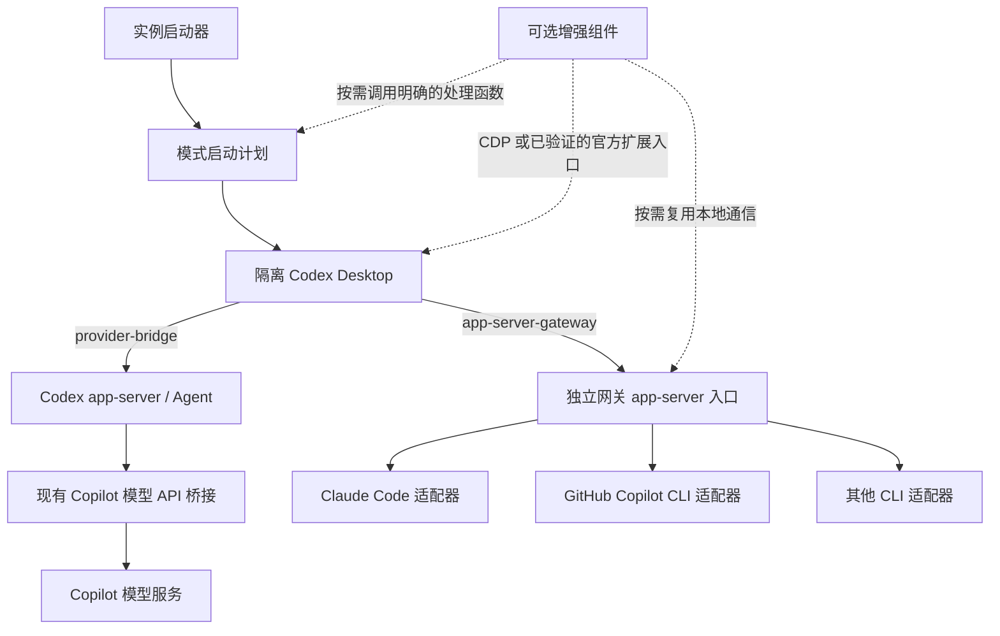

# ADR 0001：可选接入模式、独立 app-server 网关与客户端增强解耦

> 宿主选择已被用户明确修正：最终增强当前 ChatGPT，不能另开独立 profile。以 [ADR 0002](0002-current-chatgpt-host.zh-CN.md) 为准。本文的隔离实例方案保留作开发验证，不作为最终用户入口。

- 状态：开发分支实施中；R0 已完成，R1—R3 初始源码和共享网关 UI 闭环见 [实施记录](r1-r3-gateway.zh-CN.md)，真实账号验收与发行尚未完成。
- 日期：2026-10-28。
- 源码基线：本仓库 `ba2db70`，`VERSION = 1.2.36`。
- 当前产物：架构、配置解析、共享网关和初始 CLI 适配器；未改变用户正在使用的客户端，未发布正式网关版本。
- 结构复核：首版采用普通模块和函数注入；R0 证实多连接共享状态需求，因此选择实例私有网关，仍不增加独立控制服务、插件框架或 supervisor。
- 仓库归属：沿用现有入口和职责目录；仅新增 `gateway/` 协议后端目录，不建立平行的 `mycodex/` 源码树或包。
- 实施入口：[分阶段实施与验收](implementation-plan.zh-CN.md)。
- 运行证据：[R0 兼容性记录](r0-desktop-probe.zh-CN.md)。

## 1. 要解决的问题

在同一仓库维护两种用户可选的 Desktop 接入方式，并让个人组件可以跨模式复用：

1. **模型 API 桥接**：沿用 Codex Agent，通过现有桥接使用 Copilot 模型服务。
2. **CLI 原生代理**：Desktop 直接连接独立 app-server 网关，由 Claude Code、GitHub Copilot CLI 或后续 CLI 的 Agent 执行任务。

这里的“非桥接”特指第二种方式不经过现有 Responses / Chat Completions 模型 API 桥接，也不通过宿主 Codex 模型转述任务。网关仍需做协议与事件适配。

MyCodex 是个人增强的产品名称，不是所有新增代码的包边界。客户端组件可以只使用本地业务函数；网关也必须能在没有 CDP 和自定义组件时通过协议客户端运行。两者按职责进入原仓库，不另建一套产品启动、配置、更新和测试体系。

## 2. 已确认的现状

以下结论来自源码，不能代替实际安装包或当前 Desktop 版本的运行验证。

| 当前实现 | 源码位置 | 对新增模式的影响 |
|---|---|---|
| 启动时准备 Copilot bridge 和模型目录 | [`bridge/desktop-launch.mjs`](../../bridge/desktop-launch.mjs)，`launchDesktop` | 必须先选模式，再调用模式专属准备流程 |
| Windows GUI 和发布启动器检查 GitHub 登录 | [`release/desktop-entry.mjs`](../../release/desktop-entry.mjs)、[`release/launch.mjs`](../../release/launch.mjs) | Claude Code 模式不能先被 Copilot 登录阻塞 |
| 配置生成器写入 `github-copilot` Provider | [`tools/gen-config.mjs`](../../tools/gen-config.mjs)、[`release/prepare-profile.mjs`](../../release/prepare-profile.mjs) | 网关配置不能经过这个 Provider 写入步骤 |
| 子进程环境清除 `CODEX_CLI_PATH`，实例记录要求桥接端口 | [`bridge/desktop-runtime.mjs`](../../bridge/desktop-runtime.mjs)、[`bridge/desktop-instance.mjs`](../../bridge/desktop-instance.mjs) | 需要显式启动计划和按模式区分的实例记录 |
| CDP 与账户、模型、会话、更新服务组合在同一入口 | [`bridge/desktop-patch.mjs`](../../bridge/desktop-patch.mjs) | 组件宿主不能直接导入某个模式的服务实现 |
| 模型控件读取 React Fiber，显示配置包装内部方法 | [`bridge/desktop-model-controls.mjs`](../../bridge/desktop-model-controls.mjs)、[`bridge/desktop-display-config.mjs`](../../bridge/desktop-display-config.mjs) | 与 Desktop 内部结构有关的代码要集中到版本适配层 |
| 更新兼容性摘要只遍历 `bridge/`、`tools/` | [`bridge/desktop-extension-files.mjs`](../../bridge/desktop-extension-files.mjs) | 新模块必须纳入打包、源码摘要和更新验收 |
| CLI 有原生补丁链，Windows 有 DLL 适配 | [`NATIVE_PATCH_CHAIN.json`](../../NATIVE_PATCH_CHAIN.json)、[`src/ReleaseNativeHost.cpp`](../../src/ReleaseNativeHost.cpp) | 保留既有产品路径；不把它们变成新网关的必需依赖 |

## 3. 架构决策

### 3.1 两种接入模式

| 配置值 | 用户可见名称 | 执行任务的 Agent | 模型来源 |
|---|---|---|---|
| `provider-bridge` | Codex + Copilot 模型 | Codex | 现有 Copilot API 桥接 |
| `app-server-gateway` | CLI 原生代理 | 当前会话绑定的 CLI | 该 CLI 自己的认证与模型渠道 |

没有新配置的旧安装继续走 `provider-bridge`。不会根据是否安装了某个 CLI、某个引擎是否掉线等条件自动改模式。

接入模式属于 **Desktop 实例**；引擎属于 **会话**；模型属于 **该引擎的会话/轮次**。三者不是同一个下拉框概念。

- 允许不同模式以不同配置目录同时运行。
- 修改默认模式只影响下一次启动；当前实例显示“下次启动生效”。
- 活跃实例不能复用为另一模式。用户启动另一模式时创建或聚焦对应实例。
- 网关中新会话可以选择不同引擎；已有会话始终按持久化归属路由。
- 首版不支持会话中途切换引擎。需要另一引擎时新建会话；显式历史导入作为后续独立功能。
- 在同一引擎内换模型，以引擎真实能力为准；不能把 Gemini 型号写死为某个预期版本。

### 3.2 数据路径



网关内没有用于路由、概括提示词、自动起标题或失败兜底的模型调用。标题首版由用户输入截取或使用引擎原有标题。其他模型辅助功能以后若增加，必须独立配置、明确计费来源。

### 3.3 模块依赖

延续本仓库 Node.js ESM 运行方式。首版只建立启动模式、网关协议、CLI 适配、页面增强四个变化边界，不引入新的构建框架、依赖注入容器或独立 npm 包。

原仓库的 `bridge/` 已承载模型桥接和 Desktop 集成，`release/`、`developer/`、`platforms/` 是不同安装形态的入口，`src/` 放原生辅助代码。尊重这些现有归属：共享 Desktop 行为继续维护在 `bridge/desktop-*`，独立协议后端新增顶层 `gateway/`。不为了目录命名整齐而同时迁移全部旧代码。

以下结构标明既有位置和拟新增位置，不是要求一次性创建的骨架；只有实际承担行为的文件才加入仓库：

```text
bridge/
  server.mjs                # 既有：Copilot 模型 API 桥接
  desktop-launch.mjs        # 既有：两种模式共用的 Desktop 生命周期
  desktop-mode.mjs          # 新增：模式/实例配置解析与后端选择
  desktop-backends/         # 新增：仅包含 Desktop 集成所需的准备函数
    provider-bridge.mjs      # 调用旧桥接准备，不复制其转发逻辑
    app-server-gateway.mjs   # 配置 gateway 入口和后端就绪检查
  desktop-patch.mjs         # 既有：逐步改为增强组合入口
  desktop-cdp.mjs           # 既有：共享 CDP 传输
  desktop-components/      # 新增：实际需要的模式/引擎状态/DIY 组件
  desktop-compatibility.mjs # 按需新增：版本/能力探测，复用现有挂载实现
gateway/                    # 新增职责目录，不是另一个产品或 npm 包
  main.mjs                  # 可执行入口，注册引擎
  stdio-frontend.mjs        # Desktop 各连接的薄前端，连接实例私有 IPC
  server.mjs                # 请求路由和连接/审批关联
  protocol.mjs              # Codex wire 协议边界
  threads.mjs               # 会话归属、轮次状态与最小持久化
  engines/
    claude-code.mjs
    github-copilot.mjs
release/                    # 保留：发布版入口、安装、更新与校验
developer/                  # 保留：开发版入口与同步
platforms/                  # 保留：各平台命令包装
src/                        # 保留：原生辅助代码
tests/                      # 保留：增加 gateway-*.mjs 和 Desktop 模式回归
tools/                      # 保留：打包、同步、检查脚本
```

`bridge/desktop-cdp.mjs`、`desktop-process.mjs`、`desktop-readiness.mjs` 等已有能力原地复用；两种后端只提供差异，不增加第二个 Desktop 启动器。既有账户/会话 UI 不为了统一目录一次性搬入 `desktop-components/`，实际修改到的组件再单独抽取，保持兼容导出。

顶层 `desktop/` 在 [`.gitignore`](../../.gitignore) 和 [源码发布检查](../../tools/check-source-publication.mjs) 中属于生成资源，不能当作新源码目录。未来如需把全部客户端集成从 `bridge/` 提取成中立目录，应作为单独的、覆盖两种模式的重构，不与首次网关功能混合。

类型靠近其使用边界，用现有 ESM/JSDoc 风格或必要的局部声明；不新建顶层 `contracts` 包。生成的协议 schema 是版本验证产物，不再手工维护另一套完整类型系统。

依赖方向及实现方式：

- `gateway/main.mjs` 用一个静态 `Map` 注入引擎工厂；`server.mjs` 不导入具体 SDK，不做动态插件发现。
- `release/`、`developer/`、平台入口共用 `bridge/desktop-mode.mjs` 的模式解析，在认证/桥接准备前作出选择；不能各维护一套默认值和分流规则。
- `bridge/desktop-backends/app-server-gateway.mjs` 负责客户端与网关的接线；`gateway/` 不反向导入 Desktop/CDP 或安装入口。通用文件工具可以复用，但不能把 profile、认证或启动副作用带入网关。
- 引擎适配器不读 DOM、不调用 CDP、不修改 Codex 应用包。
- Desktop 适配器不包含模型请求、CLI 会话或认证业务。
- 组件调用注入的具体处理函数，不直接读 `~/.codex`、CLI 会话文件或桥接端口；不经层层 Service / Manager 转发。
- 只有旧模式适配器可调用旧桥接准备流程。通用模块不得通过导入带副作用的 `bridge/auth.mjs` 等模块间接绑定旧 profile。
- 模式、路径和外部操作通过参数传入；只在有隔离测试需求时注入文件系统/时钟，不对每个纯函数强加依赖接口。

后端按选择延迟导入：未选旧模式时不能因为加载模式注册表就执行 Copilot 配置初始化。`bridge/desktop-patch.mjs` 的顶层账户/profile 绑定必须逐步变为参数或模式专属处理函数，不能仅把文件移进新目录就声称解耦。

协作时按职责提交小改动：先公共启动器增加后端注入点，再新增 gateway 模块，随后接入引擎和组件。共享生命周期修复只有一个实现；测试、源码校验和发布清单继续属于原仓库。独立 npm 包、额外锁文件、独立更新器都不是本次目标。

### 3.4 必需逻辑与按需组件

“模块独立”不要求每个模块独立进程。R0 在同一个 Desktop 实例观察到三个完成初始化的 app-server 子进程，历史读取和发送也可能走不同连接。因此选择多个薄 stdio 前端连接同一实例私有网关，由后者单独拥有引擎与会话状态。CDP 增强沿用既有 helper，与网关执行逻辑互不依赖；不再为网关增加独立 supervisor 或管理 HTTP 服务。

| 项目 | 首版取舍 | 何时才增加 |
|---|---|---|
| 网关路由、引擎适配、会话归属、审批关联 | 必须保留 | 它们直接决定任务是否发给正确的 CLI |
| 模式接口 | 两个准备函数及一个入口分支 | 出现更多真实模式时再扩展，不先建策略框架 |
| 全局 `services/` 与独立控制 API 服务 | 不新增 | 第一个真实跨进程调用出现时加最小通信适配 |
| 通用插件 SDK、自动发现、热安装和市场 | 不新增 | 需要独立分发第三方组件时另作设计 |
| 薄 stdio 前端 + 实例私有网关 | 基于 R0 多连接证据选用 | 同一实例共享会话状态和请求归属；由现有启动器管理，不接管全局 daemon |
| 独立 supervisor / 系统常驻服务 | 不新增 | 后续明确要求脱离 Desktop 生命周期长期运行时另行评估 |
| 存储实现与完整事件日志 | 必须保存关键状态，不建设事件平台 | R2 对照现有原子 JSON 与可用的嵌入式 SQLite，选择满足一致性要求且更简单的实现；逐 token 存储另行论证 |
| 原生 Codex 引擎、统一会话管理面板 | 延后 | 用户确实需要网关内的 Codex 执行，或原生历史界面无法满足需求时 |
| HostServices 平台与官方 app-server 常驻辅助进程 | 不预设 | 实际启动轨迹证明某个宿主方法必需且需要委托时 |

依赖隔离通过少量模块边界测试验证：新增一个引擎只需增加适配文件和注册项；移除增强模块仍可运行协议测试；网关模式不得触发旧模式的登录、桥接启动或 Provider 配置写入。目录数量不是解耦的验收指标。

## 4. 配置、启动与实例归属

### 4.1 配置契约

配置样例：[旧模式](examples/provider-bridge.json)、[网关模式](examples/app-server-gateway.json)。它们是拟议格式，当前启动器尚不读取这些文件。

控制配置拟放在 `~/.mycodex/config.json`，由共享的 `bridge/desktop-mode.mjs` 解析，只保存选择和非敏感路径，不保存 token。这里是运行时数据位置，与源码是否建立同名目录无关。`configVersion` 与程序版本分开。

| 字段 | 语义 |
|---|---|
| `defaultInstance` | 下次未指定实例时的选择 |
| `instances[].id` | 稳定实例标识，限制为小写字母、数字、短横线 |
| `instances[].mode` | 两种接入模式之一 |
| `instances[].gateway` | 仅网关模式允许；默认引擎和启用的引擎实例 |
| `engines[].id` | 一个配置好的引擎实例；同一适配器可以有多个实例 |
| `engines[].adapter` | 适配器注册标识，如 `claude-code`；不作为核心的封闭枚举 |
| `engines[].executable` | 用户选择并验证的本地可执行文件绝对路径；不得用 shell 字符串拼接 |
| `extensions.enabled` | 此实例启用的组件 ID；服务能力不足时组件显示不可用原因 |

目录策略由模式推导；外部引擎首版统一使用 CLI 自管认证。不增加只有一个有效值的 `auth` 字段或与 `mode` 重复的 `profilePolicy` 字段。

缺失新配置：保留旧启动行为。新配置存在但错误：报告错误，不悄悄按旧模式启动。启动参数只覆盖本次启动；保存默认值是另一个显式操作。

拟议命令（**尚未实现，不能按此文直接使用**）：

```text
ccodex desktop --instance legacy
ccodex desktop --instance agents
ccodex desktop mode set-default agents
ccodex desktop diagnose --instance agents
```

模式由选中的实例决定，不提供重复的模式覆盖参数。修改已有实例的模式需新建隔离实例，不能重新解释已有目录。

### 4.2 启动计划

先解析模式和实例，再准备模式资源，最后启动 Desktop。`LaunchPlan` 是普通数据与少量回调，不是启动任务调度框架。公共启动器接收已有实例/快照信息，模式的 `prepare(context)` 只返回差异：

```text
PreparedMode {
  appServerCommand,
  envPatch,
  uiHandlers,
  checkBackend,
  disposeOwned
}
```

公共启动器不认识 Copilot 登录和 API 端口。旧模式的准备函数调用既有实现；网关模式的准备函数验证 CLI/协议入口并提供不同的环境。已有 `launchDesktop` 的 `start`、`preflight`、`readiness` 等注入点可以渐进改造，不必先重写整个启动器。

现有环境清理先执行；经过验证的 `envPatch` 最后仅应用于这个 Desktop 子进程。R0 已在 Desktop `26.1023.50603` 验证 `CODEX_CLI_PATH`、`CODEX_APP_SERVER_FORCE_CLI=1` 和独立用户目录有效；这些是当前安装代码的接入契约，不是官方稳定扩展 API，其他版本需重新验证。

R0 已证明 Desktop 能启动自有 stdio 入口，也证实多个前端连接。R1/R2 的产品实现采用“Desktop → 薄 stdio 前端 → 实例私有 IPC → 单一网关 → CLI 引擎”。实例准备函数先建立网关，stdio 前端只加入该实例，不各自启动一个引擎状态库。网关退出、前端重连与正在执行任务的清理需要显式生命周期；不自动重放结果未知的任务。

启动预检还会传入 `--print-startup-config`，`-c` 覆盖可在 `app-server` 前面，不能假定第一个参数是子命令。若产品需要官方 CLI 提供辅助信息，只允许显式列出的无推理命令，并清理覆盖变量，防止递归。R0 的测试后端没有启动官方模型或辅助 Agent。

公开 app-server 协议不等于 Desktop 承诺支持替换后端。若某版本需要私有启动适配，把它限定在 `bridge/desktop-compatibility.mjs` 及现有专属挂载模块；不要为了启动成功而改写任意请求、绕过账户检查或伪造已登录状态。

### 4.3 状态目录与切换

- 旧模式保留安装时原有目录及读写语义，不迁移原有聊天。
- 新模式使用 `~/.mycodex/instances/<id>/`：`codex-home/`、`desktop-data/`、`gateway-state/`、`run/`、`logs/`。
- CLI 的登录与原生会话目录按该 CLI 支持的机制管理；不假定所有 CLI 都支持某个自造 HOME 变量。
- 快照可作为经校验的只读资源复用，实例数据不共享。项目工作目录可以相同，但跨引擎并发修改同一文件不获得额外隔离保证。
- 新实例记录使用独立版本，包含模式、配置代次、Desktop 身份、网关身份、可选 CDP 身份；网关模式不要求 `bridgePort`。
- 记录 PID 与进程生命周期标识，复用和停止前重新验证归属。只停止自己启动且仍可确认的进程。
- 切换默认项采用原子写；活跃实例保持原配置快照。重复启动应聚焦同模式同配置实例，否则报告需要新实例或等待退出。

## 5. 网关与引擎契约

### 5.1 协议边界

官方文档说明 app-server 支持结构化请求、流式事件和反向审批；初始化使用 `initialize` / `initialized`，并可由目标 CLI 生成匹配版本的 schema。首版选择 stdio 作为 Desktop 前端；其他传输按实际版本验证，不以实验性 WebSocket 支持推断生产兼容。详见 [OpenAI Docs：App Server](https://learn.chatgpt.com/docs/app-server)。

协议映射只存在于 `gateway/protocol.mjs`。不向原生 wire 对象任意添加自定义必填字段，也不把自有控制方法混进 Desktop 协议。

| 请求类别 | 拟议处理方 | 约束 |
|---|---|---|
| 初始化、连接能力 | 协议适配层 | 每个连接独立协商，不能全局共享初始化状态 |
| 模型目录、新建会话 | 网关目录和路由 | 模型目录携带可逆的内部引擎映射；不是模型名关键词猜测 |
| 恢复、读取、执行、打断、归档会话 | 持久化归属指向的引擎 | 不按当前默认引擎重新路由 |
| 工具、审批、用户输入 | 引擎事件与回调映射 | 与具体连接、会话、轮次、请求关联 |
| Desktop 所需文件/配置等宿主能力 | 按实测方法增加的明确处理函数 | 每个方法有明确实现或受控委托；未知方法不一律转发 |
| 未实现的能力 | 版本匹配的协议错误或真实可用性结果 | 不返回伪造成功、空完成或虚假账户/额度 |

必要时启动官方 app-server 提供已确认的宿主方法；这是辅助服务，不是第三方引擎的上层 Agent。其方法白名单不能包含用于后台标题/路由的推理入口。只有以后实现并由用户选择 `codex` 引擎时，才能将该会话的推理发送到 Codex。

宿主辅助进程退出不得直接杀死其他引擎已在执行的任务；但若其承担必需的授权或操作能力，受影响的新操作必须暂停或失败，不能绕过约束继续。

### 5.2 引擎接口

以下为接口设计，省略具体类型定义；不是某个厂商 SDK 的现成 API。

```text
EngineAdapter {
  probe() -> version, availability, authStatus, capabilities
  listModels() -> models, availability
  createSession(options) -> EngineSessionRef
  resumeSession(ref, options) -> EngineSessionRef
  readSession(ref, page) -> SessionProjection
  startTurn(ref, input, options, eventSink) -> TurnHandle
  interruptTurn(handle) -> InterruptResult
  resolveRequest(requestRef, decision) -> Resolution
  archiveSession(ref, archived) -> Result
  disposeSession(ref) -> Result
  shutdownOwned() -> Result
}
```

`probe`、`listModels` 可以访问认证/目录服务，但不得以发送测试提示词来隐式消耗推理额度。引擎启动按需进行；缺少一个 CLI 不阻止其他已配置引擎工作。

`capabilities` 至少说明：输入类型、恢复、打断、审批类型、会话内换模型、归档、工具可视化、MCP 接入，以及是否真的具备 OS 级沙箱。未经验证的能力为 `unknown`，不能默认 `true`。

适配器内部按顺序优先采用该 CLI 支持的 SDK/结构化会话协议。Claude Code、Copilot CLI 的具体版本和接口需要分别验证；首版不把终端 ANSI 文本解析当作可靠工具/审批协议。未来 CLI 不必修改网关核心，但必须实现注册契约及测试。

### 5.3 会话、事件与恢复

网关必须持久化会话归属，但不需要因此先建设数据库平台。状态由实例单写者管理；R2 比较现有原子 JSON 文件与目标 Node 运行时可用的嵌入式 SQLite，按关键状态是否需事务、恢复可靠性、列表规模和实现成本选择。原型可从每会话一份有版本 JSON 与内存索引开始，但要验证实例锁、串行更新、持久性和崩溃恢复，不把文件替换误当作跨系统事务。不能直接向官方 Codex SQLite 写入伪装会话。

SQLite 是嵌入式存储，不是额外常驻服务；若它比自己编写事务、日志和恢复机制更简单可靠，应直接使用。存储封装在 `threads.mjs`，不改变引擎接口。无论选择哪一种，都不增加 ORM、独立迁移服务或完整事件溯源框架。

每个会话持久化：`publicThreadId`、`engineId`、`nativeSessionId`、`cwd`、模型选择、归档状态、标题、创建时间、最近轮次和协议投影版本。公开 ID 使用稳定的不透明 ID，真实归属从持久化元数据读取。临时没有 native ID 的创建状态需明确记录，不能靠模型前缀重建归属。

CLI 原生历史是继续执行的依据；网关投影用于列表和显示。两边不构成跨系统事务：先记录创建意图，再调用 CLI，随后持久化 native ID；崩溃后仅在有可靠关联证据时对账，否则标记待恢复，不自动重发任务。

实时事件在内存中保持归属和顺序；创建意图、轮次开始/终结、归档等关键状态持久化，不把每个正文 delta 同步写盘。CLI 能可靠读回历史时从原生历史重建；不能读回时保存有界的已完成 item/轮次投影，或明确该能力尚不支持。历史恢复是必需能力，逐 token 回放不是首版目标。

每个轮次只能有一个终结状态。请求 ID 按连接隔离，反向审批使用单独的映射和代次，不能把两个窗口里的同号请求混在一起。

- 一个会话同一时刻只允许一个活动轮次；首版不支持的 steer/排队必须明确拒绝。
- `turn/start` 不是天然幂等：客户端存在可靠请求标识时去重；结果未知时报告未知，不自动再执行一次。
- 断线后重新读取可靠历史/已保存投影，可能丢失尚未落盘的显示增量；不能重放工具调用或将读历史变成新的推理。
- 未确认引擎终止前保持“正在取消”；超时标记恢复/失败状态，不提前展示成功取消。
- 失去发起审批的连接时先暂停；恢复使用新的请求代次，旧答复失效。超时依适配器取消，不自动批准。
- 客户端断开不触发任务重试。引擎可安全继续时记录结果；无法继续时明确失败/中断。
- 进程退出、真实完成、用户中断、协议异常必须区分；缺失 token/费用数据保留未知。
- 多连接目录分页由网关生成稳定游标，包含引擎集合/目录代次，不能把某个 CLI 的游标直接用于合并列表。

### 5.4 权限与认证

模式配置、网关和 CDP 不复制 GitHub/Claude/OpenAI token；认证留在对应 CLI 或现有旧桥接中。UI 只获取脱敏账户状态。

Codex 的权限字段与外部 CLI 的审批/沙箱不是自动等价的。适配器必须记录映射；用户要求的边界无法落实时拒绝该会话或要求明确选择该引擎实际支持的策略，不能默认跳过审批。审批呈现不等于 OS 级文件隔离。

Desktop 前端仍使用 stdio；多前端到网关的私有 IPC 由实例拥有：Unix socket 或 Windows named pipe 加本地权限控制和实例握手，不开放公共管理端口。若回退到 TCP，只监听 loopback 并验证实例凭证。CDP 本身不能视为组件沙箱；只加载用户明确安装的受信任代码。日志不记录凭据，完整提示词/工具输出的诊断记录应独立控制保留策略。

## 6. 客户端增强复用

### 6.1 组件服务与展示分离

首版使用静态组件数组和普通函数。每个组件提供 `activate(context)` 并返回清理函数；不建立插件加载器、自动发现或通用事件总线。只把已被组件实际使用的函数注入 context，例如：

```text
ExtensionContext {
  instance: { id, mode },
  capabilities,
  handlers: { readInstance, setDefaultInstance, listEngines },
  desktop: { mount },
  signal,
  logger
}
```

这些是 **MyCodex 自有接口**，不是官方插件 manifest 字段。新增组件需要会话或账户能力时，再补对应处理函数；能力可以由明确的字段/可选函数表达，不建立全局能力注册中心。

同进程直接调用函数。renderer 到 helper 复用现有 CDP binding 的请求/回复方式，在边界校验动作、参数和实例归属；若 helper 与网关确需通信，优先复用已存在的私有 IPC，否则增加最小的受限通道，而非另起 HTTP 管理服务。不同进程间仍需序列化和请求关联，不能用“函数注入”掩盖这个成本。跨进程消息带版本，不提前定义一整套公共控制 API。

“设置下次默认实例”与“改变当前会话引擎”必须是不同操作。首版使用原生模型选择与历史界面承载引擎选择和聊天，不重做统一会话管理、额度中心和账户体系。

一个组件后续可以增加官方插件 UI 或 CDP 展示适配器，共用业务函数；首版不要求每个组件同时实现两种展示。原生输入栏、模型控件附近的插入由 CDP 适配。具体官方扩展能力需在目标 Desktop 最小插件上验证，不在本 ADR 宣称四种 UI 扩展已全平台可用。

### 6.2 现有能力的拆分方向

| 当前功能 | 复用的部分 | 必须抽离的业务/宿主依赖 |
|---|---|---|
| CDP 连接 | 请求关联、超时、连接清理、上下文失效处理 | 具体账户/会话事件名与分发路由 |
| 账户与用量面板 | 布局、交互、状态展示 | 账户来源；不同引擎额度不能冒充 Copilot Credits |
| 模型/Context 控件 | 展示与选择体验 | 模型目录来源、可支持参数、React 回调定位 |
| 会话管理 | 筛选、列表、批量交互 | provider 模式原有存储与 gateway 会话索引分别实现 |
| 更新提示 | 提示组件 | Desktop、网关、CLI、组件各自的版本/更新服务 |
| Work IQ 与其他 DIY 组件 | 独立业务服务和 UI | 工具是否注入当前 CLI，由引擎能力与显式配置决定 |

组件卸载要取消订阅、清理定时器和 MutationObserver、还原自身 DOM/方法包装。包装的方法被其他模块再次替换时，不能强行覆盖对方。重新注入要幂等，观察器排除自身变动并合并刷新。

CDP、React 和内部方法适配必须按 Desktop 版本/能力探测。某个挂载点失效，只停用该组件并报告原因，不终止网关任务。关闭全部增强时，网关仍需通过协议测试；若原生页面因模型过滤必须依赖某个兼容补丁，应如实把它记录为该 Desktop 版本的 UI 前置条件。

官方插件的工具、登录、mentions、skills 和 Hooks 不会因为页面可见就自动进入外部 CLI。工具接入必须另建明确的适配和权限映射；首版不能把整套 Codex 私有工具运行时当作所有引擎共有能力。

## 7. 兼容性和更新边界

维护一个经过验证的组合：Desktop 版本/资源摘要、app-server schema 摘要、网关协议版本、组件宿主 API 版本、引擎 CLI/SDK 版本。分别记录“源码推断”“协议测试通过”“真实 Desktop 验证通过”，不能混为一个兼容标记。

启动时先做版本和能力检查；更新时在隔离实例验证候选组合，再切换指针。保留旧可执行版本不足以保证回滚：持久化状态升级也必须有备份、版本检查和可恢复策略；新程序不能让旧版本误读新 schema。沿用现有发布/更新路径，不为每个模块再建独立更新服务。

不要将最新官方文档字段直接套在仓库固定的 `0.162.1` 上。wire schema 应由目标安装的 CLI 生成；R0 实测 Desktop 调用 `getAuthStatus` 和 `turn/addUserMessage`，两者未出现在该 CLI 生成的公开 schema 中。因此必须结合实际轨迹和版本化 Desktop 扩展契约，不能把公开 schema 通过等同于原生页面兼容。输入接纳接口的去重、排队、审批和取消仍需要完整实现，不能把测试桩的单轮行为当作产品实现。

2026-10-29 用户明确本轮只完成 macOS 本机开发与使用闭环；不依赖 PowerShell、Windows runner 或原仓库匹配发行产物。测试使用既有 shell 调度器。Windows/Linux 及正式跨平台发行另行安排，届时沿用根目录 `AGENTS.md` 的发行流程；当前本地实现与验证不表示安装包已经新增网关，也没有更改原生补丁或版本号。

## 8. 社区代码参考与复用边界

`gkorepanov/ccodex` 和本仓库同名但不是同一实现。参考基线为其 `449d51930ad81aecf537683cf0dbc1d29ac38cb2`（v0.5.19）。

| 可参考位置 | 可借鉴内容 | 本设计额外要求 |
|---|---|---|
| `src/desktop/stdioFrontend.ts` | Desktop stdio 前端与网关连接 | 实例私有路径、版本化启动契约、跨平台验证 |
| `src/gateway/server.ts`、`connection.ts` | 请求分发、反向请求与通知 | 引擎注册表；避免核心直接耦合 Claude |
| `src/claude/session.ts`、`inputMapper.ts`、`toolMapper.ts` | Claude 会话与工具事件转换 | 放入 Claude 适配器，按实际 SDK 版本验证 |
| `src/gateway/catalog.ts`、`src/claude/native/` | 历史读取与协议投影 | 所有权、索引和 CLI 原生数据的边界明确 |
| `tests/gateway/schema.test.ts` | 用目标 Codex schema 验证输出 | 加入启动轨迹、错误、审批、恢复和多连接测试 |

其 `src/gateway/titles.ts` 含内部 Codex 推理；本设计不继承这个隐式调用。`stock.ts` 的进程故障耦合及全局安装/接管行为也不能原样移植。

参考代码采用 MIT 许可；真正复制代码时保留对应版权与许可，并记录源提交。当前设计与 R0 探针未复制社区源代码或引入第三方二进制。

- [固定版本源码](https://github.com/gkorepanov/ccodex/tree/449d51930ad81aecf537683cf0dbc1d29ac38cb2)
- [MIT 许可](https://github.com/gkorepanov/ccodex/blob/449d51930ad81aecf537683cf0dbc1d29ac38cb2/LICENSE)

## 9. 首版范围与未决验证

首版目标：保留旧模式；新增隔离网关实例；Claude Code 和 GitHub Copilot CLI 分别完成真实会话闭环；提供模式入口及引擎状态组件；能够在 Copilot CLI 实际提供的模型目录中选择 Gemini。

首版不包含自动跨引擎迁移、隐式模型降级、远端网关、全量官方工具继承或完整替代 Codex 客户端。

必须先验证：

1. 目标 Desktop 的进程替换入口、实际 argv/daemon 行为，以及无 Copilot API 桥接时的启动与账户呈现。
2. 除聊天之外，哪些宿主 RPC 是界面正常启动和浏览历史所必需的。
3. Claude Code、Copilot CLI 在目标版本上的恢复、审批、取消和模型目录能力；Gemini 是否对当前账户可用。
4. 关闭注入后的协议可用性，以及模型选择 UI 是否需要最小兼容补丁。
5. 实例私有 IPC、单写者存储和前端重连的跨平台实现；R0 已确定需多个前端共享网关，不接管现有全局 daemon/socket。

这些验证影响实现细节；若不满足，应收缩并明确兼容范围，而不是退回宿主模型转发来冒充完成。
