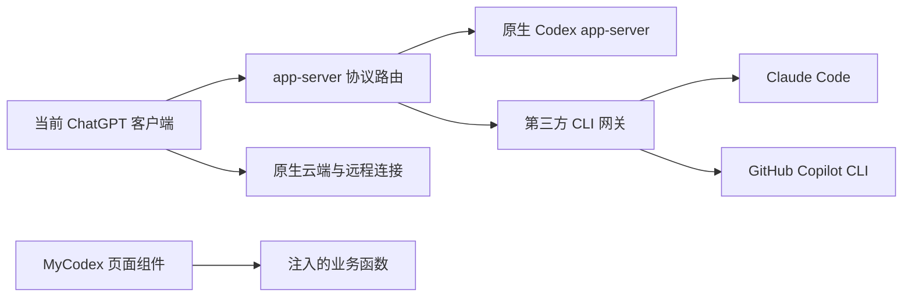

# ADR 0002：增强当前 ChatGPT 客户端，延后统一重启

2026-10-28 用户明确修正的产品约束。本记录优先于 ADR 0001 中把隔离 Desktop 实例作为最终用户入口的假设。

## 已确认的要求

1. MyCodex 的宿主是用户当前安装、正在使用的 ChatGPT 客户端，沿用其现有窗口、登录、配置和历史。
2. 允许在需要时重启当前 ChatGPT；不创建另一个 Codex/ChatGPT 应用副本或独立用户 profile 作为日常入口。
3. 当前有会话运行，禁止现在重启、结束客户端进程、替换它的后端连接或修改运行中 profile。等用户明确安排后再统一重启启用。
4. 保留原生 Codex 的会话及功能。第三方 CLI 会话明确选择引擎后走网关，不通过宿主 Codex agent 进行推理转接。
5. 2026-10-29 用户明确本轮只需 Mac 本机开发、接入与验收。PowerShell、Windows runner、六平台候选和原仓库匹配发行产物不是本轮前置条件；不因其缺失暂停 macOS 实现。正式跨平台发行另行安排。

本轮使用 macOS 的 Node/CLI 与既有 shell 任务调度器完成本地验证。原仓库 `AGENTS.md` 的全平台发布流程保留用于正式发行；本轮范围按上述用户明确要求执行。需要继续完成的是当前客户端启动接入、页面选择器和真实 CLI 联调，不是补齐 Windows 发布环境。macOS 本地可用与正式发布分别记录，不把二者的完成条件混用。

## 对已有代码的影响

`gateway/` 的 CLI 适配器、协议投影、持久化、审批隔离继续复用。2026-10-29 已为 `bridge/desktop-backends/app-server-gateway.mjs` 增加仅准备入口，并由 `desktop-current-host.mjs` 接入原应用；早期 `host: "isolated"` 路径仍只用于开发验证。用户已实际启用并反馈缺陷；最新修复与待验收项见下文“首次真实使用后的修复”，此前测试记录保留作为历史证据。

独立快照继续用于开发测试，不能把“隔离副本能回复”当成“当前 ChatGPT 的原生功能与第三方引擎已兼容”。也不能通过删除 `assertPrivateDesktopHome` 等隔离保护，把现有原型强行指向用户原 profile。

关键边界是原生通道与第三方通道的协议路由。路由只接管本地 CLI；官方云端和远程连接继续由原客户端选择：



原生请求保留原协议、账号、历史与工具能力；第三方线程根据持久化归属路由。第三方接口不支持时明确失败，不能退回原生 Codex 执行用户任务。模型列表、历史分页、反向审批、通知与请求 ID 的合并必须单独验证，不能只在请求前加一个条件。

## 本轮源码与验证

沿用 `gateway/` 的职责，不新建 MyCodex 源码包。现有共享网关继续承载第三方会话；每个 Desktop stdio 连接增加协议路由和它自己启动的原生 app-server 子进程。

| 模块 | 职责 |
|---|---|
| `bridge/desktop-current-host.mjs` | 检查、准备与显式启用分开；检查安装摘要、配置及源码代次；启用前若原应用仍运行，直接拒绝；保留原 profile |
| `bridge/desktop-backends/app-server-gateway.mjs` | `stage()` 只生成私有配置和 shim；`prepare()` 才启动或复用网关；当前宿主使用 routed stdio |
| `bridge/desktop-cli-selector.mjs` | 可注入业务函数的选择器；读取真实 CLI 目录、显式创建空线程；与版本化页面导航分离，不写原生默认模型 |
| `bridge/desktop-gateway-ui.mjs` | 独立 CDP helper，复用原 CDP 传输；核对 app 生命周期、调试端口归属和主 frame，只提供列模型、列 CLI 会话、建会话三个业务入口 |
| `gateway/routed-stdio.mjs`、`native-peer.mjs` | 原生 CLI 启动探测与协议传输；保留原生 `HOME` / `CODEX_HOME`，清除递归路由变量；仅回收自己启动的 CLI 子进程 |
| `gateway/router.mjs` | 原生初始化、账号、配置及未知原生扩展透传；第三方模型使用 `mycodex/<engine>/<model>` 命名；已有线程按持久化归属分流 |
| `gateway/rpc-peer.mjs` | 保留调用方请求 ID、错误及响应附加字段；两条后端通道的反向审批 ID 独立映射 |
| `gateway/merged-page.mjs` | 合并模型与历史分页；签名游标保存尚未消费的页尾，可由另一 stdio 连接继续使用 |
| `gateway/state.mjs` 的只读归属接口 | 网关离线或引擎移除后仍识别第三方线程；前端不参与状态恢复或写入 |

首屏可选模型/历史发现最多等待第三方网关 1.5 秒，失败时返回原生结果。显式选择第三方引擎后的任务失败会直接报错。两者不能混淆：目录缺席可以降级，用户任务不能偷偷改由原生模型执行。

第三方模型不会成为原生默认模型。含第三方模型或 provider 的原生配置写入（包括混合批次）整体拒绝；不会先写其中一部分。这也意味着必须实测 Desktop 的选择器是否依赖这种写入。若依赖，应在独立组件的业务函数中保存第三方会话选择，再显式创建线程，不能冒充原生配置保存成功。

当前关闭与故障处理覆盖：网关连接/初始化中关闭、反向审批断线、原生 app-server 意外退出。原生子进程退出时 stdio 前端退出并报告失败；它不自行重启 Desktop，也不重发任务。

2026-10-28 本轮验证：

- 57 项定向测试通过，包含旧启动路径、当前宿主只读检查、模式配置、SDK 事件适配、真实子进程/IPC，以及路由、审批和跨连接分页测试。没有启动 Desktop 实例。
- 模块解析检查通过：131 个 ESM 模块、256 个相对 import。
- 使用已安装官方 CLI `0.165.0-alpha.1.2`，在新建临时 `CODEX_HOME` 中运行对照协议探针：原生初始化、账号/配置响应、模型列表、原生空线程创建与读取、确定性第三方 turn 及其列表合并通过。见 [原生路由证据](evidence/2026-10-28-native-routing.json)。
- 该探针没有真实模型调用。原生历史列表计数为 **0**，所以其中历史包含关系检查不构成真实已登录历史验收；有内容的混合分页由合成数据测试覆盖。原生对第三方线程的 `thread not loaded` 响应只证明该原生进程没有加载它。
- Desktop 旧默认字段 `multiAgentMode=explicitRequestOnly` 按该版本生成 schema 中的“deprecated / ignored”语义兼容；其他覆盖仍拒绝。此项与默认 collaboration envelope、`thread/items/list` 的 1000 条上限已通过协议测试，**尚未复验页面 UI**。

探针复现命令（须通过仓库任务调度器执行）：

```sh
node tools/probe-native-routing.mjs \
  --native-cli /Applications/ChatGPT.app/Contents/Resources/codex-cli/CodexCLI.app/Contents/MacOS/codex
```

探针只启动 CLI，结束后清理自己的进程和临时 profile，保留报告与日志。`routed-stdio.mjs` 本身没有启动、退出、修改 Desktop 的能力。2026-10-29 已制作当前宿主准备配置，但没有执行启用；它不经过旧隔离启动器。

## 当前宿主的检查、准备与启用

配置使用 `host: "current"`，必须明确填写 `desktopApp`，且不能填写替代 Desktop profile。示例见 [current-chatgpt-inspect.json](examples/current-chatgpt-inspect.json)。既有网关隔离原型必须显式填写 `host: "isolated"`；遗漏宿主类型会报错，避免默默启动错误的客户端。

```sh
node bridge/desktop-launch.mjs \
  --config docs/architecture/examples/current-chatgpt-inspect.json \
  --inspect-only
```

此检查可在当前会话运行时执行。实测识别到原 ChatGPT 进程和匹配的文件摘要，未创建实例目录。返回的 `gatewayStateHome` 只是未来网关数据目录，不是给 ChatGPT 设置的 profile。报告见 [当前宿主检查证据](evidence/2026-10-28-current-host-inspection.json)。

当前检查固定 macOS ARM64 与已验证安装摘要；应用更新后先复验，不凭版本号猜测兼容性。检查结果仍标记 `activationReady: false`，表示真实当前宿主的完整 UI 验收未完成。省略全部操作参数仍立即拒绝，不隐式启用。

已实现的安全准备命令（先将配置中的 `sdkPath` 指向已安装的可信 SDK；没有打包 runtime 时样例不能直接用于准备）：

```sh
node bridge/desktop-launch.mjs --config /absolute/path/config.json --prepare-only
```

它只导入 SDK、生成私有 socket 目录、连接配置、shim 和 `current-host-prepared.json`。不启动 CLI、模型推理、网关或 Desktop，也不写原生 profile。准备记录绑定应用/CLI 文件摘要、当前源码代次、配置代次和 Node 路径，变更后必须重新准备。实际已在原 ChatGPT 运行期间完成准备；另使用临时空目录验证生成的 shim 可透传官方 CLI 版本，见 [本机准备证据](evidence/2026-10-29-current-host-prepared.json)。

**下列命令仅在用户统一安排退出后执行，本轮没有运行：**

```sh
node bridge/desktop-launch.mjs --config /absolute/path/config.json --activate
```

启用先拒绝仍运行的 ChatGPT，再核对准备记录；启动私有网关、原安装路径及单独 UI helper。只为本次应用进程提供路由环境和 loopback CDP 参数，保留 `HOME` / 原生 `CODEX_HOME`，禁止 Desktop profile 覆盖。不复制 app、不更改 ASAR/CLI、不写全局启动环境；启动失败也不会自动结束当前应用。helper 错误写入实例目录内权限为 `0600` 的 `current-host-ui.stderr.log`，避免后台挂载失败时无诊断信息。

本机开发配置位于 `~/.mycodex/development/ccodex-current-mac.json`，初始仅配置已登录的 Copilot CLI；后续已按用户确认追加 [Codex + Copilot provider](0005-codex-copilot-images.zh-CN.md)，等待用户手动重开启用。网关状态在同目录 `instances/current-mac/`，它不是 ChatGPT 的 profile。连接密钥和机器路径不提交到源码。退出增强会话后，下次普通打开原 ChatGPT 不会继承这组进程环境；此停用流程仍需随后实际验收。

## Mac 日常一键入口

2026-10-29 用户选择使用独立 MyCodex 启动图标，不修改官方应用。已在本机 `~/Applications/MyCodex.app` 安装约 254 KB 的入口，并通过 Finder「添加到程序坞」固定到 Dock。该 `.app` 只含原生启动外壳、图标和本地路径绑定；实际客户端仍是原 `/Applications/ChatGPT.app`，没有客户端副本或新 profile。

此前已获用户重启授权，但自动正常退出等待超时，后台接续流程结束，未强制结束进程。用户随后手动重启的是普通客户端，未生成增强启动回执。本次安装入口时保留这个运行实例，未再次重启。

| 状态 | 入口行为 |
|---|---|
| ChatGPT 未运行 | 先校验安装摘要，再复用现有准备和启用函数；不弹终端 |
| 同一配置的增强实例已运行 | 核对进程生命周期、网关和 UI helper，回到该窗口 |
| 普通实例已运行，或配置已改变 | 提示在合适时退出后再点 MyCodex；不强制结束、热换后端或再开实例 |
| 官方应用或依赖不兼容 | 显示错误，保留从原图标普通启动的能力；不静默绕过校验 |

首次从普通实例切换仍需要退出一次；此后日常直接点 MyCodex，无须每次执行脚本。原 ChatGPT 图标、外部链接唤起和官方更新自动重启不保证经过该入口。未安装登录项、全局环境变量、常驻启动监控或独立更新服务。

职责仍在原目录中：`bridge/desktop-launcher-macos.swift` 负责原生提示与前台激活；`bridge/desktop-shortcut.mjs` 判断复用/准备/启用；后者继续调用既有 `desktop-launch.mjs`，不另写后端启动逻辑。`tools/install-macos-launcher.mjs` 构建入口、生成原创图标并进行本地 ad-hoc 签名，拒绝覆盖官方 app 或无归属标识的应用。Swift 源码纳入现有源码摘要及文本审计。

本机入口依赖当前源码目录、Node 和 SDK 的已配置路径，未复制这些运行时。移动仓库或清理相关缓存后应重新安装/配置入口；它不是已经发布的独立离线安装包。重建方式（通过既有 shell 重任务调度器执行）：

```sh
node tools/install-macos-launcher.mjs /absolute/path/config.json
```

验证：26 项启动相关测试及 3 项源码摘要测试通过；真实 Swift 编译、应用签名和 Info.plist 检查通过。安装后的二进制 `--check` 返回 `needs-quit`、`launchPerformed: false`，原 ChatGPT 进程保持不变。Dock 配置确认只有一个 MyCodex 固定项。这些证据证明入口已安装和当前实例受到保护，**不等于已完成当前 ChatGPT 内的网关/UI 验收**。见 [入口验证记录](evidence/2026-10-29-macos-shortcut.json)。

## 2026-10-29 首次真实使用后的修复

用户通过 MyCodex 启动了原 ChatGPT，并报告找不到新建会话、发送失败。启动回执与 Desktop 文件日志确认增强已启用；网关中已创建的会话仍存在，失败消息尚未进入 CLI（没有保存 turn 或 CLI session ID）。这是接入兼容性缺陷，不能归因于用户的目录填写方式。

本轮修复保持在现有职责中，没有引入新的服务、框架或客户端副本：

| 问题与证据 | 修复位置与行为 |
|---|---|
| 全局 `CODEX_APP_SERVER_FORCE_CLI=1` 让此版本 `J7` 对云端/远程 WebSocket 返回空，增强启动后日志出现云端 originator 过滤和 pinned thread 读取错误 | 当前客户端使用的 routed backend 不再设置这个变量；`CODEX_CLI_PATH` 只供原生本地 CLI 启动路径使用，云端连接由官方客户端选择。真实云端恢复仍须重启验收 |
| `CODEX_CLI_PATH` 也被本地 Work 的 `exec-server` 使用；旧转接入口拒绝非 app-server 命令，导致连续失败重试 | `gateway/routed-stdio.mjs` 透传其他命令的参数、stdin/stdout/stderr、退出状态及关闭信号。修改后原客户端下一次重试于上海时间 13:59:18 恢复 rendezvous 连接，没有重启 ChatGPT |
| 实际发送返回 `Gateway does not support the Codex permissions override.` | `gateway/protocol.mjs` 接受此版本的 `:danger-full-access` 命名档位与包含 cwd 的单个项目目录；其他命名沙箱、混合权限字段和额外工作区仍拒绝 |
| 附件、排队和目标读取报 unsupported；会话元数据不完整，未覆盖 `recency_at` 排序 | 为已有 CLI 线程返回空附件/队列与空目标，补齐 Thread 元数据、默认可见名称和 recency 排序；不宣称支持这些功能的写操作 |
| 创建入口没有持久的会话找回位置，工作目录每次手填 | 现有业务函数新增 `listThreads`；组件提供最近 CLI 会话、分页、再次打开、最近目录补入以及上次目录/模型记忆。原生侧栏共存仍需实际验收 |
| 快速重启可能复用仍存活的旧网关代码 | backend 对网关源码绑定 `runtimeGeneration`，拒绝复用旧代次；一键入口只在 ChatGPT 已退出后等待旧服务自动退休，最多 75 秒。不结束活动应用或 CLI turn |

权限语义：命名“完全访问”不等于网关自动批准工具。`on-request`/`untrusted` 仍通过 CLI 的逐次确认；若客户端发送 `never`，网关不会询问，也不会把它转成全量授权，需要授权的 CLI 操作将被拒绝。文本发送可用，不支持的 Codex 沙箱/模型推理档位仍会明确报错。

验证包括独立浏览器的 11 项交互检查，以及真实 Copilot `gpt-6-astra` 的首次文本发送、续聊、历史与页面只读初始化协议。探针使用临时 native profile、独立工作目录和新 CLI session；原生推理调用在 native peer 入口计数/拦截，实测为 0。见 [真实参数联调](evidence/2026-10-29-copilot-desktop-envelope.json)、[组件报告](evidence/2026-10-29-selector-recovery-ui.json)、[组件示例](evidence/2026-10-29-selector-recovery-ui.png)。示例不是当前 ChatGPT 截图。

本轮没有重新启动、关闭或直接操纵当前 ChatGPT 窗口。当前进程仍含旧启动变量，常驻网关/UI helper 也仍加载旧模块。用户在任务结束后 `⌘Q` 退出并点击现有 Dock MyCodex，才会加载本轮剩余修复；升级首次启动可能等待旧网关约一分钟，无须重装入口。原有会话 JSON 保留并由新代码兼容读取。

尚未完成：重启后真实页面发送与审批、原生云端历史/插件共存、侧栏发现及停用增强验收。相关测试和 CLI 成功不替代这些证据。本次没有发布发行包或修改官方应用文件。

47 项相关单元/协议测试分别通过，模块检查覆盖 137 个 ESM 与 281 个相对 import；不是全仓测试。一次测试因继承增强宿主的递归保护环境而失败，修正测试子进程的环境后通过，未放宽产品保护。完整范围与限制见 [本轮兼容性修复记录](evidence/2026-10-29-current-host-compatibility-fix.json)。

## 2026-10-29 此前的本机进展

- 65 项相关测试分别通过：首次集合 64/65；唯一失败为测试回收自己网关时的 macOS 进程观察竞态，修正测试等待后该项单独通过。包含真实 shell shim、私有网关子进程启动/复用、配置变更拒绝与清理。不是全仓测试通过；见 [验证记录](evidence/2026-10-29-mac-validation.json)。
- Copilot CLI `1.0.105` 已完成用户设备授权。实际账号目录未返回 Gemini，因此本轮使用明确存在的 `gpt-6-luna`，没有伪造 Gemini 选项或自动回退模型。Claude 仍待登录。
- 真实 Copilot 的文本回复、第二轮原生 CLI 会话恢复及网关历史读取通过：[文本/恢复证据](evidence/2026-10-29-copilot-text-resume.json)。探针为原生 Codex 创建临时空 profile；CLI 使用当前用户的原生登录和新建测试会话，不接触原有任务。恢复是 SDK 运行时停止后重建并恢复，不是完整 ChatGPT 重启恢复。
- 待审批时真实取消通过：返回 `interrupted`、只产生一个终结事件、网关无活动 turn、历史状态保存、工作目录未变，见 [取消证据](evidence/2026-10-29-copilot-interrupt.json)。仅覆盖这一取消阶段，不代表所有工具运行中断场景都已验证。文本/恢复及取消探针在原生 peer 的 `call` 入口计数并拦截推理请求，实测为 0；创建 CLI 任务没有经过宿主模型。
- 真实拒绝写入、一次性批准指定临时文件写入通过：[权限证据](evidence/2026-10-29-copilot-permissions.json)。首次同会话尝试因先前拒绝后没有第二个工具请求而未通过，保留[首次记录](evidence/2026-10-29-copilot-permissions-first-attempt.json)；改为新测试会话后通过，未放宽许可条件。旧权限报告的 `nativeInferenceTurns` 尚未计量，不能单独用其零值证明无宿主调用。
- 选择器在独立无头浏览器中通过 8 项检查：模型标签转义、防双击、导航失败重试、连续创建、卸载、重复注入、生成脚本的 binding 往返和未知页面版本拒绝挂载：[报告](evidence/2026-10-29-selector-ui.json)、[示例截图](evidence/2026-10-29-selector-ui.png)。这是合成页面，**不是当前 ChatGPT 内的运行截图**。生成脚本测试使用 loopback 安全来源，以提供真实浏览器的 `crypto.randomUUID`；初次 `about:blank` 测试缺少该 API 而失败，修正了测试页面来源，未削弱组件版本检查。
- 页面入口由 Shadow DOM 组件、普通业务函数和版本化导航适配组成；CDP helper 只负责允许的模型、会话读取/创建调用与结果返回，连接密钥不进入 renderer。没有增加通用组件框架、管理 HTTP 服务或第二套发布机制。

仍待实际验收：当前宿主启动/页面导航、已有原生历史和插件共存、真实 UI 审批展示、Copilot 其他中断阶段与用户提问、Claude 的真实任务，以及停用和更新流程。现有测试不能替代这些证据。

## 接入证据与未知

只读检查当前已安装的 Desktop `26.1023.50603`：

- `CODEX_CLI_PATH` 被客户端读取，也用于 `exec-server`；`CODEX_APP_SERVER_FORCE_CLI=1` 会关闭包括云端在内的默认 WebSocket 路线，因此当前宿主增强不能设置它。
- `CODEX_ELECTRON_USER_DATA_PATH` 控制 profile；当前宿主路线不能沿用隔离验证时重设它的做法。
- 这些是此版本的本地实现证据，不是官方承诺长期兼容的插件 API。
- 官方 [Codex 平台说明](https://developers.openai.com/blog/codex-as-a-platform) 说明 app-server 提供客户端协议；该说明本身不证明已安装 ChatGPT 支持第三方后端热切换。

已实现的启用代码将在未来统一重启时，仅为当前应用进程设置接入环境，启动原安装路径并保留原 profile；不改 app.asar、不覆写官方 CLI、不写全局 shell/launchctl 环境。目前还未验证这一方案对当前客户端全部通道的影响，不能称为本机产品验收完成。

页面组件使用官方扩展点或版本化 CDP 适配，独立于后端路由。CDP 如需下次启动开启调试，也并入同一次重启；当前不改正在运行的客户端。

## 下一阶段验收

- 当前宿主准备路径已接入既有 `bridge/desktop-*` 生命周期；后续实际验证启用。启用只能发生在用户安排的统一重启中，不启动应用副本或另设日常 profile。
- 原生 Codex 请求/事件透明往返，无额外模型调用；原生历史、插件、文件操作与审批不因安装网关消失。
- 第三方会话只进入选定 CLI；原生与第三方请求 ID、线程 ID、历史分页和审批互不串用。
- Copilot 已登录并完成上述文本、恢复与权限探针；继续验证中断、用户提问和页面流程，再完成 Claude 登录与真实任务。Git 仓库凭据不替代模型认证；Copilot 的 Gemini 选项仍以实际目录为准。
- 禁用增强后，下次普通启动恢复原接入方式；无需回滚客户端二进制或迁移 profile。
- 更新后能力检测失败时停用相应增强，不能猜测内部接口或接管活动会话。
- 当前运行实例不受测试和配置准备影响。启用动作留待用户安排的统一重启，不自动执行。
