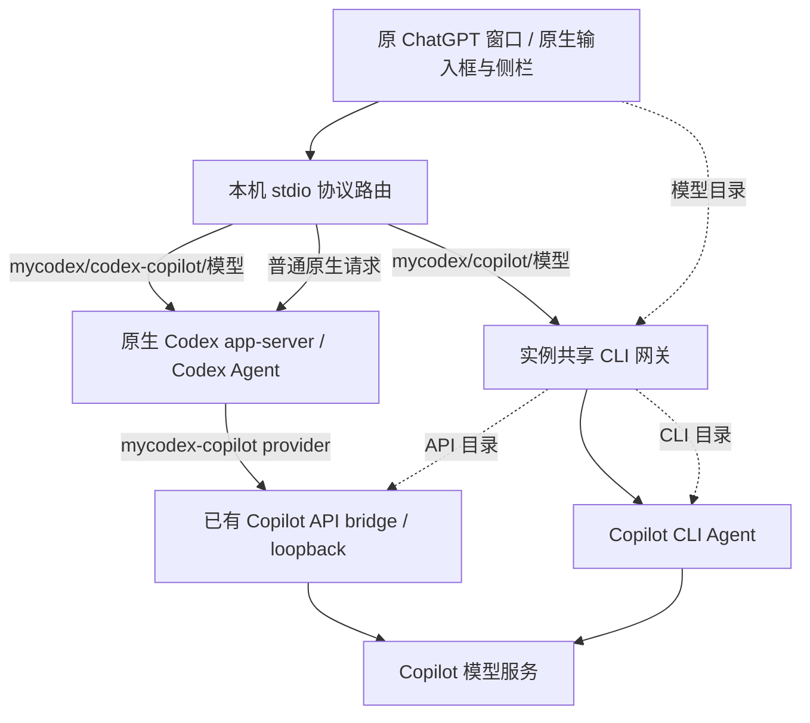

# ADR 0005：Codex + Copilot、图片输入与双模型目录

2026-10-29，macOS 当前宿主开发。保留 [原生窗口接入](0003-native-session-integration.zh-CN.md) 和 [CLI 会话控件](0004-cli-session-controls.zh-CN.md) 已有行为；不迁移旧会话，不替换官方客户端或 native core。

**状态：已载入当前窗口，原窗口交互仍待验收。** 2026-10-29 上海时间 19:07 接续检查确认：MyCodex 入口返回 `activate-existing`，当前源码摘要与启动回执一致，原生 app-server 已带有 Copilot provider 参数；实际目录包含 16 个 API 模型和 15 个 CLI 模型，两个 Gemini 均在 API 目录中，无目录警告。此次检查没有退出、重启或重新配置当前客户端，也没有生成新发行包。详见[接续检查记录](evidence/2026-10-29-codex-copilot-current-host.json)。

此前用户已确认“准备配置，我稍后手动退出重开”。当时本机私有实例配置已追加 provider，原 CLI 条目和默认值未改；当时的 MyCodex 入口只读检查返回 `needs-quit`、`launchPerformed: false`。这条准备记录是历史状态，不能覆盖上述当前运行状态。

## 两条明确的执行路径



`codex-copilot` 在网关中只提供模型目录，不执行任务。线程创建、恢复、模型设置和消息进入原生 app-server；使用 Codex 工具、原生沙箱/审批及原生历史。provider 定义通过子进程参数注入，模型目录按线程覆盖，不写原 profile 的 `config.toml`，不改全局默认 model/provider。

`copilot` 保留 CLI SDK 执行、网关历史和 CLI 审批。原有 CLI 会话仍走原路径，不能通过改模型名称跨引擎迁移；普通原生会话也不能被悄悄转换。明确的引擎选择只作用于新建草稿。

新建列表区分 **Codex + Copilot** 与 **Copilot CLI**，GPT 的 Codex + Copilot 条目优先排列，原始 Codex 入口仍保留。仅选择模型不创建线程。Codex + Copilot 草稿保留原生权限、协作模式及附件；创建后恢复原生模型/推理控件，不显示 CLI 审批策略。模型别名在路由处还原为真实 API ID；`thread/settings/update` 同样还原别名，支持原生控件修改后续轮次的模型/推理。

## 目录与图片

- CLI 与 API 分别读取实际登录账号的目录，不合并为虚假的 CLI 能力。本机 API 目录有 16 项，包含 `gemini-4-argon`、`gemini-3.8-flash`；CLI 目录有 15 项，不包含 Gemini。目录与能力随账号和服务变化，不硬编码这些型号。
- API 目录读取前验证本地 bridge 身份和认证。失败会显示目录警告，不把缺项伪装成完整目录，也不使用旧目录掩盖未登录。
- 原生 Codex 的图片输入直接保留给 native app-server。Copilot CLI 将原输入框的 `image` data URL 或绝对路径 `localImage` 转为 SDK blob attachment，支持纯图片消息；历史保留输入形状以便恢复。
- CLI 接受 PNG/JPEG/GIF/WebP，校验声明、base64、文件签名和普通文件类型；图片总量每轮最多 4 MiB。不下载远程图片，不读取 FIFO，不无限读取增长文件。不支持的输入在执行前明确失败并保留草稿。
- 模型目录分别发布 `inputModalities`，无图片能力的 CLI 模型在发送前明确拒绝；不宣称所有未来模型都有视觉能力。

## 本机启用配置

在当前 `host: "current"` 实例的 `gateway.engines` 中追加以下条目，保留原 Copilot CLI 配置和 `defaultEngine`：

```json
{
  "id": "codex-copilot",
  "adapter": "codex-copilot",
  "bridgeHome": "/absolute/private/path/copilot-provider",
  "bridgePort": 22690
}
```

`bridgeHome` 必须为独立私有绝对目录，不能位于原 `.codex` profile 中；不能添加 `sdkPath` 或替换 native executable。这里的账号登录与 CLI 原生登录相互独立；macOS 不假定可以复用 CLI 的 keychain。未登录时经用户确认后进行 GitHub device flow，凭据只存在本机私有目录，不进入仓库。

只有 prepare 会启动该显式配置的旧 API bridge，stage/inspect 不登录、不推理、不启动 bridge。实例配置或源码变化时，活跃网关保持原样；同实例退休等待可以跨越配置 generation 变化，不能热换连接配置。原生 frontend 的 provider 启动参数也需要完整重开后才加载，不能只热更新网关就宣称当前窗口已启用。

## 已有证据与剩余验收

[脱敏调用证据](evidence/2026-10-29-codex-copilot-images.json) 记录：

- 固定本机原生 Codex 在隔离 HOME/CODEX_HOME 下调用真实 API：`gpt-6.1-sol` 使用 `xhigh`，两个 Gemini 使用各自目录默认推理；均识别合成红图，原生进程重启后恢复同一历史，CLI 网关推理计数为 0。
- 原生协议确定性测试实际启动固定 native app-server，检查 HTTP Responses 中的 `input_image`、`reasoning.effort: xhigh`、原生 `thread/settings/update` 后的 `low`，以及冷启动恢复；不依赖真实模型或 Desktop。
- 真实 Copilot CLI 图片轮次成功，历史保存，native 推理计数为 0，无工具调用。
- 隔离浏览器 fixture 覆盖新标签、Gemini 选项、图片草稿、原生权限保留、CLI 策略显隐和原生控件恢复；没有操作用户当前 Desktop。

当前窗口已加载 provider，无须为加载配置再次重启。2026-10-29 上海时间 19:09，用户在原窗口新建草稿并展开引擎菜单后明确反馈“三项都能看到”，确认 Codex + Copilot、`gemini-4-argon` 和 `gemini-3.8-flash` 均可见。这项确认仅覆盖菜单可见性。

尚需在原窗口确认：选择 Codex + Copilot 模型后粘贴/拖入图片并发送、已有 CLI 历史和原侧栏不变、原生 provider 线程再次重开后续聊及原生模型/推理控件真实交互。后续涉及客户端重启时仍先与用户协调。fixture 和隔离 native 重启不能冒充这些原窗口验收。

接续检查经现有 shell 调度器运行 27 项定向测试，全部通过；包含固定 native app-server 的图片与推理参数传递、原生历史冷恢复、草稿生命周期和路由隔离。检查只读发现 3 条既有 CLI 记录、12 个 turn，其中 2 条有持久化 CLI session ID；这些计数不证明原窗口侧栏和历史显示已验收。当前应用的界面读取被工具限制，未改用 CDP 绕过，也未发送或重放用户会话消息。更早的[隔离调用证据](evidence/2026-10-29-codex-copilot-images.json)保留其原始范围。

没有运行 PowerShell、Windows runner 或六平台构建，`VERSION` 保持 `1.2.36`。Claude 登录与视觉能力不在本轮通过范围。
