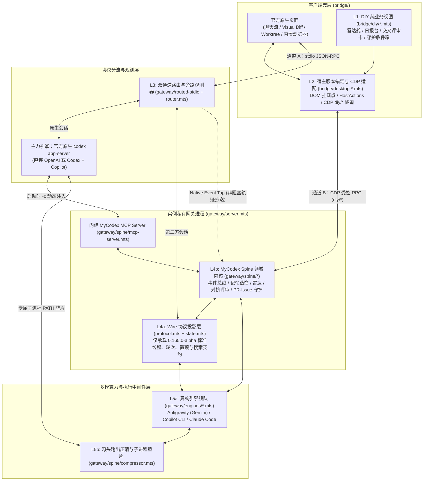

# ADR 0017：MyCodex 共生内核架构、原生会话介入水位与自有产品域蓝图

- 状态：架构设计与分层规范已确立（2026-10-31）；本轮仅落盘架构文档，未修改运行中源码、客户端实例、`VERSION` 或用户会话数据。
- 前置基线：[ADR 0001](0001-multi-mode-app-server.zh-CN.md)（多模式网关）、[ADR 0002](0002-current-chatgpt-host.zh-CN.md)（复用当前 ChatGPT 宿主）、[ADR 0008](0008-typescript-diy.zh-CN.md)（TypeScript DIY 组件与构建门禁）、[ADR 0015](0015-core-session-management.zh-CN.md)（核心会话管理）。

## 1. 产品定位与演进原则

MyCodex 的长期目标不是做一个依附在边缘的“第三方 CLI 启动器”，也不是脱离官方生态从零重写一套聊天客户端，而是构建 **「共生内核（Symbiotic Spine）」**：

1. **借船进化（最大化复用官方宿主与主力 GPT）**：保留官方 ChatGPT Desktop 的聊天流、多文件 Visual Diff 审查、Git Worktree 视图、内置浏览器与 Computer Use 等原生体验，将 **GPT + 原生 Codex Agent**（官方订阅及 `Codex + Copilot` 桥接）作为核心攻坚与日常主架构师。
2. **长出自有灵魂（沉淀跨引擎个人产品壁垒）**：把官方因商业立场或通用定位不会提供的能力——**异构双模型对抗评审、跨引擎全轨迹记忆与日报蒸馏、定制信源 AI 雷达、多账户配额精算分流、带硬熔断器的 PR/Issue 守护、无损输出压缩**——收敛进独立的 **MyCodex Spine** 领域内核。
3. **原生与异构平权互通**：所有 MyCodex 自有领域服务必须同时服务于 **原生 Codex 会话** 与 **网关第三方 CLI 会话（Copilot CLI、Antigravity Gemini、Claude Code）**，并在桌面 UI 与纯命令行终端两侧共享同一套后端实现。

---

## 2. 全栈分层模型（五层职责与防腐边界）

当前系统天然具备两条汇交于同一实例私有网关（`gateway/server.mts`）的通信链路：**通道 A（Electron 主进程 stdio 标准 JSON-RPC）** 与 **通道 B（`desktop-gateway-ui.mts` 的 CDP 受控旁路连接）**。在此基础上确立五层职责边界：

### 各层准入与防腐铁律

| 层级 | 目录归属 | 核心职责 | 严禁事项（防腐底线） |
|---|---|---|---|
| **L1：DIY 纯视图层** | `bridge/diy/*.mts` | Shadow DOM / 纯 DOM 业务面板，只消费注入的 `services` 与 `HostActions`，返回 `{ host, dispose() }` | 严禁引用官方混淆符号（如 `VUn`、`eLt`）、React Fiber、Node API 或本地路径；保证官方前端升级时业务视图零修改 |
| **L2：宿主版本适配层** | `bridge/desktop-*.mts` | 核验版本/ASAR 摘要、定位稳定 DOM 挂载锚点、暴露标准 `HostActions`（打开线程、预填草稿、注入输入框）、转发 `diy/*` CDP 请求 | 严禁写入具体插件业务逻辑；不在每个新增插件时重复修改 CDP 绑定白名单 |
| **L3：主进程路由与观测层** | `gateway/routed-stdio.mts` `gateway/router.mts` | 按会话归属分流标准 `app-server` 协议；启动原生 `codex` 时动态挂载内建 MCP 与子进程环境；非阻塞抄送原生会话生命周期事件 | 严禁在此层塞入插件私有数据查询；除非需要混入原生侧栏/模型选择器，否则 DIY 交互一律走通道 B 绕过 L3 |
| **L4a：标准协议投影层** | `gateway/protocol.mts` `gateway/state.mts` | 维护 CLI 会话的 `StoredThread`、轮次状态、置顶、归档、删除与分支契约 | **严禁污染聊天存档**：不把雷达报告、日报草稿、PR 巡检状态塞进 `StoredThread` |
| **L4b：MyCodex Spine 内核** | `gateway/spine/*.mts`（拟增） | 承载自有产品能力、统一事件总线、定时/触发状态机、熔断器与独立持久化（`<home>/gateway/spine/*`），同时向 CDP（面向人）和内建 MCP（面向模型）暴露接口 | 不反向导入 CDP 或 Electron 生命周期；脱离桌面 UI 时仍可通过 CLI / MCP 独立运行与测试 |
| **L5：引擎与执行中间件** | `gateway/engines/*.mts` `gateway/spine/compressor.mts` | 封装异构 CLI / ACP SDK、配额感知模型选择与确定性输出压缩流水线 | 不直接读写前端状态；外部写操作受审批策略与熔断闸门约束 |

---

## 3. 介入「原生 Codex 会话」的四个物理水位

官方原生 `codex app-server` 是编译后的 Rust 二进制，其内部存在一个 **“模型推理 $\rightarrow$ 本地工具执行 $\rightarrow$ 结果直发云端”的闭环黑盒**。例如当原生 GPT 执行 `exec_command("npm test")` 时，数千行原始日志会在 Rust 进程内部直接拼入下一轮云端请求，事后才向 `router.mts` 发送 `item/completed` 通知用于界面展示。此时在 `router.mts` 修改消息已无法节省云端上下文与额度。

因此，MyCodex 向原生会话注入能力时，按 **物理拦截位置与维护成本** 严格区分四个水位，优先采用 **水位 1—3**，避免常规功能落入 **水位 4**：

1. **水位 1：官方配置与内建 MCP 注入层（首选，零侵入）**
   - **机制**：在 `routed-stdio.mts` 拉起 `native` 时，利用官方支持的 `-c mcp_servers.mycodex=...` 动态挂载内建 MCP Server（不写死用户 `~/.codex/config.toml`）。
   - **能力边界**：让原生 GPT 会话直接主动调用 AI 雷达、读写个人知识库、发起异构双模型交叉审查、按行号回读被压缩的旁路原始日志。
2. **水位 2：专属子进程执行垫片层（源头级输出拦截）**
   - **机制**：在 `native-peer.mts` 启动原生 `codex` 子进程时，仅在该子进程的 `env.PATH` 前端注入 `<home>/gateway/shims`（不影响用户本机交互式终端）。
   - **能力边界**：在 `Shell -> Rust` 管道源头对高频高噪命令（测试运行器、构建日志、超大 `git diff`）做确定性降噪与旁路无损落盘，使压缩后的高信噪比摘要进入原生 GPT 上下文。
3. **水位 3：协议总线旁路窃听与原生会话编排层（轨迹与派单）**
   - **机制**：在 `router.mts` 对 `thread/*`、`turn/*` 与完成事件做只读非阻塞抄送（Event Tap），并允许 Spine 通过协议主动创建/分支原生线程。
   - **能力边界**：无感采集原生 GPT 会话产出供晚间日报与知识蒸馏使用；PR/Issue 守护任务可直接拉起真正的原生 Worktree 会话，复用官方 Visual Diff 面板供用户审阅。
4. **水位 4：原生 Rust 二进制补丁层（`patches/*.patch`，严格受控）**
   - **机制**：修改上游 Rust 源码并维护 `NATIVE_PATCH_CHAIN.json` 重新编译二进制。
   - **能力边界**：每次官方客户端更新均会产生重编译与摘要核验成本；仅保留给无法通过水位 1—3 实现的底层核心刚需，任何 DIY 领域插件不得依赖修改原生二进制。

---

## 4. 五大自有产品域规格要点

### 4.1 输出压缩网关（Output Compression Gateway）
- **两级无损流水线**：
  - **L1 确定性结构化降噪（零模型消耗）**：剥离 ANSI 控制符与动态进度条刷新；按命令模板折叠全绿通过项（如 `node --test` / `pytest` / `cargo test` 汇总为通过计数，**100% 完整保留失败断言、堆栈与上下文**）；归并重复报错行并过滤 lockfile 级噪音 diff。
  - **L2 旁路原文落盘（Lossless Spillover）**：超出阈值的原始输出完整写入 `<home>/gateway/spillover/<sessionId>/<callId>.log`，返回末尾附带精确指针；原生 GPT 与 CLI Agent 均可经 `mycodex.read_log(id, startLine, endLine)` 按需无损回读，严格遵守“绝不静默截断丢弃真实错误上下文”的工程准则。

### 4.2 每日 AI 雷达原生化（Actionable AI Frontier Radar）
- **复用既有数据内核**：保留现有 `ai-agent-frontier-radar` 的 Python 采集脚本（如 `fetch_x_frontier.py`、`radar.py`）与 `report.schema.json` 作为唯一数据契约，淘汰独立外部浏览器阅读器依赖。
- **低成本异构调度**：由 Spine 调度器触发采集，去重与评分显式路由至独立额度的轻量通道（如 Antigravity `gemini-3.8-flash`），锁定白名单脚本权限避免后台弹窗阻塞。
- **一键派单闭环**：原生抽屉卡片支持本地偏好加权/降权，并提供 **「结合当前仓库评估」**、**「临时沙盒试跑 Demo」**、**「沉淀为知识卡」** 三个直通会话动作。

### 4.3 全引擎个人日报与认知蒸馏（Unified Daily Digest & Distillation）
- **消除跨引擎盲区**：自动聚合三路真实轨迹——① 网关 CLI 会话记录（`StoredThread`）；② `router.mts` 抄送及原生存储读取的原生 GPT 会话增量；③ 工作区多仓库当日 `git log` 与活跃分支状态（可选联动 `bridge/workiq/`）。
- **一源三出**：对接既有 `journal.py` 与 `vault_writer.py`（`knowledge-card-v2.schema.json`），一次生成 **团队脱敏日报**、**次日早间一键续接看板（Morning Handoff）** 与 **排障经验候选知识卡**。

### 4.4 双模型对抗评审（Adversarial Dual-Model Verifier）
- **异构净室审查（Clean-Room Review）**：强制使用不同于主写作者的模型家族（例如 `codex-copilot` 高推理档 $\leftrightarrow$ `antigravity/gemini-4-argon` 或 `claude-code`）；不传入主会话冗长辩解过程，仅组装 **原始任务目标 + 压缩净化后的真实 `git diff` + 仓库核心约束**。
- **强制只读隔离**：审稿会话固定以 `read-only` 权限运行，允许自主查阅关联源码验证调用链，严禁写文件。
- **双向触发与回流**：既可通过底栏 DIY「交叉评审」按钮勾选分级缺陷（`P0/P1/P2/Nit`）一键注入当前会话修复，也可由原生 GPT 通过 `mycodex.review.cross_check` 主动发起会诊。

### 4.5 带四重熔断器的 PR & Issue 守护（Repo Guardian）
- **双轨自治能力**：
  - **PR 守护轨**：监测 CI 失败或新增 Review 评论 $\rightarrow$ 经压缩网关提取失败根因 $\rightarrow$ 在隔离 Git Worktree 生成原子修复并跑通单测 $\rightarrow$ 产出待批阅补丁与回复草稿。
  - **Issue 哨兵轨**：监测新 Issue 或追问 $\rightarrow$ 查重并只读检索本地代码库定位疑似根因（Code-Grounded Triage） $\rightarrow$ 产出 **内部诊断报告（含可选候选补丁）** 与 **对外礼貌脱敏回复草稿**。
- **四重硬熔断器（Circuit Breaker）**：
  1. **同错指纹熔断**：连续 2 轮修改后归一化错误签名未消除，或失败用例数上升，立即挂起（`TRIPPED_SAME_ERROR`）。
  2. **预算与轮次硬顶**：硬限制单事件最大轮次、单次修改文件数上限及单日总守护配额；初筛优先走低成本引擎，确认动刀再按需升级主力引擎。
  3. **爆炸半径熔断**：命中 `.github/workflows/*`、发布/权限脚本、凭据配置或大面积删改时立即阻断标红。
  4. **外部写操作硬闸门**：默认禁止后台自动 `git push`、合并 PR 或公开发送 Issue 评论；所有外部副作用统一进入 **MyCodex 待批阅收件箱** 由人工一键确认放行。

---

## 5. 分阶段实施路线图

每一步保持独立可测、可回滚，先通协议与测试桩，再接原窗口验证：

1. **阶段 P1：Spine 底座、内建 MCP 与输出压缩网关**
   - 建立 `gateway/spine/` 目录、受控 `diy/*` RPC 分发与 `desktop-gateway-ui.mts` 通道扩展；
   - 实现 `compressor.mts`（测试/日志降噪 + 旁路原文落盘）及内建 `mycodex` MCP 的 `read_log` 能力；
   - 在 `bridge/diy/` 实现通用原生侧边抽屉容器与 `HostActions` 契约。
2. **阶段 P2：每日 AI 雷达与全引擎日报原生接入**
   - 接入 `router.mts` 原生会话轻量 Event Tap；
   - 对接本地 `ai-agent-frontier-radar` 与 `personal-daily` / `daily-self-distillation` 的 JSON Schema 及 Python 脚本，完成卡片渲染与一键转会话派单。
3. **阶段 P3：双模型对抗评审**
   - 打通净室 `git diff` 组装、异构只读路由、底栏评审按钮及 MCP `cross_check` 工具闭环。
4. **阶段 P4：带熔断器的 PR & Issue 守护**
   - 实现 `gh` 增量巡检、隔离 Worktree 调度、四重熔断状态机与待批阅收件箱放行闭环。
