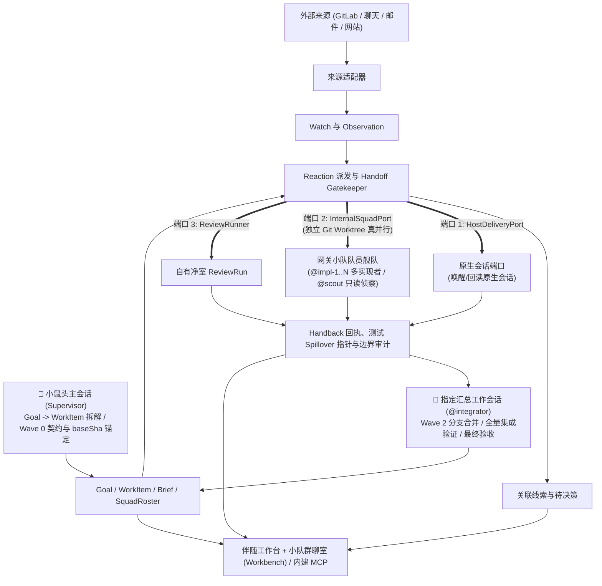

# ADR 0026：P3 关注驱动的协作与伴随工作台

日期：2026-11-03（Asia/Shanghai）。状态：技术方案收敛稿（已合入小鼠头 Supervisor 主动拆活、多实现者独立 Git Worktree 并行委派与小队群聊工作台交互），待按本文实施与验收。

P3 在现有 Spine 上补充跨会话工作的有效约定、关联、主动输入、**小鼠头（主会话 Supervisor）主动拆活与多队员（Squad）并行委派**，以及汇总验收闭环。用户继续在原生会话与小鼠头主会话里思考、决策和拆解目标（Goal → WorkItem），由网关托管的多名异构/同构队员会话（多名实现者、只读侦察/审稿员）在各自独立的 Git Worktree 中并行推进，最终交由指定汇总工作会话（Integrator）合并、联调与验收，并在伴随工作台（含小队群聊时间线）统一呈现。GitLab 反馈是首个外部主动输入来源；聊天、邮件、网站变化通过同一关注与处理契约接入。交叉评审是其中一种受限只读执行能力。

本文是 P3 当前唯一有效规格，替代此前“独立交叉评审托盘”和后续补充段落，不再保留相互冲突的实施要求。下面的类型、接口、目录增量和默认策略均为设计；已有基础及尚未打通的能力分别在第 2 节列出。

## 1. 产品路径与首版边界

- 保留原生侧栏、项目、会话和小鼠头主会话（Supervisor）；从会话中的轻入口打开可收起的伴随工作台（集成目标约定、队员状态栏与小队群聊时间线）。
- 支持多个长期目标及子目标。目标拆解（Goal → WorkItem）、工作波次依赖（Wave DAG）、会话分支是三种关系，不能用同一棵树替代。
- 采用「联邦式小队群聊（1 角色 = 1 真实底层会话 + Spine 群聊编排总线）」：不在单个官方 Thread 内伪造混合多 Agent 状态机，而是让每名队员绑定独立的网关 CLI 会话或原生会话，在伴随工作台群聊流中统一展示派工（Dispatch）、阶段进展与交回结论（Handback），支持一键跳转队员完整会话现场。
- 支持多实现者真并行开发：当拆出多个可并行开发的功能子任务时，强制采用 **独立 Git Worktree 并发模式（Isolated Worktree Parallelism）** 派出多名实现者（`@impl-1..N`）同时编码与单测，后续由指定汇总工作会话（`@integrator` 或小鼠头主会话）合并、联调并结合净室评审完成最终验收。
- 工作台默认展示当前工作、关联进展、需要判断的事项和结果；“方向与约定”收纳路线、原则、架构、产品设计等来源，适用于开发和非开发目标。
- 选中进展、反馈或约定后，可以带来源进入讨论；保留原草稿，明确目标会话，用户主动插入讨论的动作不自动发送。返回时恢复工作台选择和位置。
- 已启用关注按规则持续接收变化。属于既有范围和授权的反馈可以自动续办；改变范围、约定或超出权限的事项才进入待决策。正常拉取不调用模型、不刷屏。
- 关闭面板或切换聊天不取消后台工作、不丢结果；重新打开根据持久记录与权威来源核对，不重放模型调用。
- 首版完成一个真实闭环：设备体验工作 → 关联两个 MR/Issue → 新反馈 → 已有负责会话处理 → 修复与复核证据 → 工作台找回结果。以网页变化的独立适配器测试信息分流，验证机制不依赖 GitLab。
- 长期记忆、全项目自动归类、全量聊天导入、通用网页抓取平台、邮件/聊天连接器全面接入延后。工作项的最小执行依据与用户纠偏生效机制属于本期。

## 2. 当前基础与前置缺口

| 已有代码 | 可复用内容 | 不能据此假定的能力 |
| --- | --- | --- |
| `gateway/spine/registry.mts` | 初始化/鉴权、方法能力、输入输出预算、内存任务计数 | `track()` 不是持久任务、幂等派发或来源调度 |
| `gateway/spine/io.mts`、`storage.mts` | 私有存储、文件校验、fsync 与原子替换、日志引用 | 单文件原子写不提供多记录事务 |
| `gateway/spine/trace.mts`、`trace-peer.mts` | 原生会话的标题、cwd、部分生命周期投影 | Event Tap 可能漏采样；不是真实任务进展或完整聊天事实源 |
| `gateway/spine/kernel.mts` | trace、knowledge、radar、daily 模块注册 | 当前没有 Goal/WorkItem、Watch、持久处理和评审服务 |
| `gateway/spine/mcp-server.mts`、`native-config.mts` | 本地原生 Codex 的 MCP 接入及现有四项读取工具 | 本地 MCP 注册不证明小鼠头可访问；被动 MCP 服务不会主动唤醒会话 |
| `bridge/desktop-diy-contracts.mts`、`bridge/diy/drawer.mts` | DiyServices、DrawerSlot、HostActions 与抽屉挂载 | 当前草稿插入只检查当前页面，不能作为后台投递指定会话的接口 |
| `gateway/routed-stdio.mts`、`router.mts` | Desktop 到原生/CLI 的请求转发 | Spine 尚无经验证的反向调用指定原生会话的通道 |
| `gateway/server.mts` | 稳定端点和单写入者、空闲退出 | 当前 Spine 模块初始化异常会进入网关整体失败路径，需先隔离 |

实施前首先验证两个能力：**后台能向已绑定原生会话可靠投递并核对回执；小鼠头能通过受授权通道读取工作依据和处理结果。** 当前会话里可用的宿主工具不等于产品后台已经获得这些工具。

若该双向通路尚不可用，来源同步和工作台可独立验证，但不得将“复制草稿”标为自动协作完成。不得为绕过限制另开独立客户端、另一个原生运行时，或经宿主模型转发每条消息。

## 3. 架构与事实归属



MyCodex 拥有跨来源协作语义；原生聊天、Git、远端工作平台继续拥有各自事实。界面可以统一展示，底层不能同时维护两个权威状态。

| 内容 | 权威所有者 | MyCodex 保存与操作方式 |
| --- | --- | --- |
| 原生项目、会话、消息、标题、归档、原生执行 | 宿主 | 带 host/account 的稳定引用、责任关系、带核对时间的投影；修改经已验证宿主端口执行并回读 |
| 仓库、工作树、分支、提交 | Git/实际文件系统 | 仓库身份、规范化工作区路径、版本引用与有界快照；不复制一套分支状态 |
| Issue、MR/PR、评论、评审讨论、CI | 对应服务 | 来源 ID、版本、必要摘要和关联；远端状态不可达时显示待核对 |
| 跨会话业务目标、工作范围、验收与责任关系 | MyCodex | Goal、WorkItem；不将一个聊天或一次执行直接当作业务工作 |
| 路线、设计、原则等原文 | 原文件、Page 或其他来源 | 采用的条款与版本、来源定位、替代关系；不另建完整文档库 |
| 关注意图、变化处理、派发意图与回执 | MyCodex | Watch、Observation、Reaction |
| 自有交叉评审执行、冻结快照和报告 | MyCodex | ReviewRun、Snapshot 与报告；原生产物以引用关联 |

原生按聊天设置的目标与预算仍由宿主管理；不能把多个会话的业务目标双写为同一个原生聊天目标。外部已有 Issue 可作为工作项的需求权威来源，正文和远端状态直接引用；本地工作项保存协作范围与验收，不创建第二份 Issue。

## 4. 最小领域模型

只引入六组持久记录；约定、责任、验收、资源绑定先作为工作项的组成部分，避免为每个概念建设独立服务。

| 记录 | 核心字段与职责 |
| --- | --- |
| Goal | id、revision、parentId、目的、状态、相关来源；允许多个根目标。父目标不能仅按子项数量或任务结束自动判定达成 |
| WorkItem | id、revision、primaryGoalId/relatedGoalIds、当前 Brief、责任会话引用、资源绑定、验收项、关联结果、业务状态 |
| Watch | id、revision、关注理由、来源范围、目标/工作关联、匹配规则、动作策略引用、启停状态、检查游标与健康状态 |
| Observation | 来源对象身份、变化身份/版本、发生与接收时间、内容引用/摘要、因果来源；表达“来源发生了变化”，不保证其内容判断正确 |
| Reaction | 变化与目标关联、动作类型、幂等键、采用的 Brief/策略版本、处理状态、尝试、宿主回执或 ReviewRun 引用 |
| ReviewRun | 输入快照、工作依据版本、实际引擎/模型/强度、执行状态、覆盖、发现与报告、取消/中断信息 |

公共引用 `ResourceRef` 包含 provider/instance/account、kind、stableId、可选 revision/locator、observedAt。标题是显示缓存，不能作关联键；本地路径不能代替跨机器仓库身份；凭据只保存私有凭据引用。

### 4.1 当前工作依据与无损派工门禁（Handoff Gatekeeper）

WorkItem 的版本化 Brief 是小鼠头与所有队员共享的唯一任务共识头（替代外挂全量 Wiki 硬塞），最少包含：

- 本次目的、范围（`scope.modify` 允许修改路径与 `scope.doNotTouch` 严禁触碰边界）与明确不做的事项。
- **无损交接六要素（Handoff Contract）**：
  1. `userVerbatimAnchor`：用户原始关键要求与约束原话锚点，防止主会话二手转述失真；
  2. `hqJudgment`（总部三段判断）：`desiredOutcome`（要的效果）、`doneCriteria`（好的样子）、`ruledOut`（用户已否决或踩坑禁止的做法，附文档 `file:line` 或日期出处）；
  3. `investigatedRefs`：小鼠头已查明的 `file:line` 与结论摘要（全新未查须显式填 `none_checked`），避免队员进场重复搜全仓；
  4. `referenceImpl`：仓库内既有参照实现 `file:line`（新建无参照须显式写 `none_new`）；
  5. `baseSha` / `baseBranch` 与绑定的独立 `worktreePath`：多实现者并行时的统一共同祖先提交与物理隔离工作树；
  6. `verificationRequired`：交回（Handback）前必须跑通的验证命令或只读检查项。
- 验收条件及所需证据类别（Git commit/diff 引用、测试退出码、P1 `spilloverId` 原始日志指针）。
- 采用的方向/约定引用、条款摘要、来源版本和采纳来源。
- 工作资源绑定：仓库、工作树、分支/提交、关联 Issue/MR、运行环境引用，以及 **小队角色编制（`SquadRoster`）与汇总负责人（`integratorRef`）**。
- 已有推进授权：允许动作、目标、范围、预算、外部写入边界、暂停/接管状态。

网关在受理 `mycodex.squad.dispatch` 或自动派发前执行强类型 `validateHandoffContract()` 门禁校验：缺少上述必填要素、引用 `/tmp` 易失路径、或并行写任务共享同一工作树时，直接拒收并返回结构化缺失项提示小鼠头补齐。

用户要求、Agent 提案、已采纳约定分别记录。用户纠正生成新 Brief 版本并指明替代关系；不能把沉默或重复引用当作采纳。来源文档更新只产生变化，未经判断不能直接覆盖当前约定。

每次评审与派发绑定采用版本，真正执行前复核。旧版本排队动作进入重新判定；已在运行的任务保留真实运行状态，按宿主支持的方式协调调整，不能靠改本地字段宣布已停止。旧结果保留并标记受哪些约定变化影响。

### 4.2 关系与完成语义

- Goal 的父子关系无环；WorkItem 之间的阻塞关系另存。会话继承记录原来源及时间，不能复制为新的独立决策证据。
- WorkItem 与会话、仓库、Issue/MR 均可多对多。关联带角色，例如需求来源、实现、排查、交付负责、评审依据。
- 每个可写资源范围在同一时刻只有一个由 MyCodex 自动派发的写入负责人；多仓业务可有不同实施负责人和统一交付负责人。
- 工作项状态建议为 planned、active、blocked、paused、ready_for_acceptance、done、cancelled。业务完成依据验收；宿主运行状态、远端合并状态分别投影。
- Issue 关闭不自动通过本地验收；本地完成不默认关闭 Issue。变更远端对象作为独立、可回读的授权动作。
- “代码修好、当前窗口恢复、根因查清、MR 推送、CI 通过、合并完成”分别记录，不能相互推导。
- 验收证据绑定组件版本组合、运行身份、时间、范围与结果。多仓场景保存版本清单，不把不同时间、不同版本的通过结果拼成一个未经联验的整体结论。

### 4.3 小鼠头主动拆活、队员能力画像与多实现者 Worktree 并行编排

**全局置顶「🟡 小鼠头🐭（Supervisor）」与项目内「汇总工作会话（`@integrator`）」职责分离**：
- **🟡 小鼠头🐭（全局常驻置顶主会话）**：位于侧栏顶部置顶区，负责跨项目情报巡检汇报、长期目标（Goal）拍板、跨项目拆解工作项（WorkItem）与波次派工；小鼠头自身不被任何单个代码仓的 Worktree 写锁绑死。
- **项目作战部队（如 `项目 → MyCodex` 下的各工作会话）**：具体代码仓下包含**指定汇总工作会话（`@integrator`，如 `开始迭代开发 P3 功能`，绑定主集成工作树）**与**多名并行队员会话（`@impl-1..N` 绑定各自独立的 Git Worktree，`@scout` 只读并发）**。
- **与已落地 P3 第二轮代码（289/289 通过）的无损衔接**：现有 `gateway/spine/work-dispatch.mts` 已按 `fs.realpathSync(a.workspace)` 实现单路径互斥锁，天然支持多名实现者在不同 Git Worktree 路径下真并发运行；P3.1 只需在 `reaction-store.mts` / `work-dispatch-contracts.mts` 上做三项无损扩展：① `reactionKey` 纳入 `subtaskId/roleId` 以支持同一工作项并行派发多张子任务卡；② `target` 扩展为 `NativeHostRef | CliSquadThreadRef` 以对接 `InternalSquadPort`；③ 支持来自小鼠头拆活的 `supervisor_dispatch` 因果源。

小鼠头主会话作为 **Supervisor（总指挥）**，队员会话作为协助完成目标与工作委派的并行执行舰队：

1. **队员能力画像与弹性实例池（`SquadRoster`）**：
   - 每个队员绑定稳定角色标识（`roleId`）、职能原型（`archetype`：`supervisor` | `implementer` | `scout_reviewer` | `verifier` | `integrator`）、底层会话引用（原生 `HostThreadRef` 或网关 CLI `GatewayThreadRef`）、实时忙闲状态（`idle` | `busy`）及配额冷却状态（`cooling_down`）。
   - **不止一名实现者**：当工作项拆出多个可并行开发的功能模块时，支持配置或按需孵化多名实现者实例（如 `@impl-1`、`@impl-2`、`@impl-3`，底层可为同引擎的独立会话或 Claude Code / Codex / Copilot CLI / Gemini 混编），只要队员空闲且子任务无前置阻塞，同一轮立即并行派发。
   - **配额冷却与无损换人（Quota Cooling & Handoff）**：当某名队员触发额度上限（429）或超时失联时，工作台标记 `cooling_down`，支持将该子任务连同当前 `Brief`、`baseSha` 与已产出分支一键交接（Handoff）给替补队员会话，保留原工作项与 Reaction 追踪链。
2. **三波次拆活与合并协议（Contract-First → Isolated Worktree Parallel → Integrator Merge）**：
   - **Wave 0（契约先行与基准锚定）**：若多个并行子任务涉及共享公共接口（如 `contracts.mts`），小鼠头先在 Wave 0 落盘公共接口契约并固定统一基准提交 `baseSha`，将该公共契约文件列入 Wave 1 各实现者的 `scope.doNotTouch`。
   - **Wave 1（多实现者独立 Git Worktree 真并行 + 只读侦察）**：
     - **物理隔离铁律（1 Worktree = At Most 1 Writer）**：每名并行实现者（`@impl-1..N`）必须绑定基于同一 `baseSha` 切出的**独立 Git Worktree**（如 `wt-impl-1`、`wt-impl-2`），各自独立编码、独立构建、独立运行模块单测，彻底杜绝构建产物互踩与 Git 索引锁冲突；
     - **只读并发（`read_only`）**：侦察与净室审稿队员（如 `@gemini`、`@reviewer`）可在同一时刻只读并发运行；
     - **两轮停滞熔断（2-Strike Escalation）**：同一队员连续 2 轮尝试未消除同一错误签名或无实际进展时，自动挂起为 `needs_attention(stalled_same_error)` 并交回小鼠头换方法或换其他引擎队员，禁止无限盲试耗尽配额。
   - **Wave 2（指定汇总工作会话合并、联调与验收）**：
     - 当 Wave 1 各并行实现者全部通过交回审计（`settled`，附净提交 `headSha`、未越界修改 `doNotTouch`、单测通过及 P1 `spilloverId` 日志指针）后，派发给**指定汇总工作会话（`@integrator`，绑定主集成 Worktree，可由专门工作会话或小鼠头担任）**；
     - 汇总会话依次合并各实现者 Worktree 分支（`git merge` / `cherry-pick`），运行全量集成门禁，并可联动净室 `ReviewRun` 对合并后的完整 Diff 做最终审查；验收通过后归档/释放临时子 Worktree。

## 5. 关注驱动的主动输入

### 5.1 来源无关契约

```ts
interface SourceAdapter {
  capabilities(): SourceCapabilities;
  readChanges(scope: SourceScope, cursor?: string): Promise<ChangeBatch>;
  readObject(ref: ResourceRef): Promise<SourceObject>;
}
interface ChangeBatch {
  observations: ObservationInput[];
  nextCursor?: string;
  coverage: "complete" | "partial";
}
```

Webhook、宿主订阅和轮询是不同到达方式，统一产生 Observation。来源专属字段可以保留在有版本的扩展数据中；公共服务不解析 GitLab 专属负载，也不把所有来源都强制转成评审评论。

GitLab 首版使用已关联、已授权项目的 Issue/MR/讨论/CI 读取，低频增量轮询、分页、退避和重连补拉。Webhook 接收条件具备时可用作检查提示，但不得要求 Mac 暴露公共端口作为首版前置，也不能仅收到通知就假定远端全量状态一致。具体实例的版本、权限和事件覆盖要在连接器验收时确认。

首轮同步先形成基线，并核对当前工作相关的未解决反馈；不自动重演全部历史。评论编辑保存新版本；乱序事件不能回退已核对的远端状态。扫描必须先可靠保存变化，再推进游标；部分覆盖或断线显示同步不完整，不能显示为“没有新问题”。

来源参考：[GitLab Webhook events](https://docs.gitlab.com/user/project/integrations/webhook_events/)。

### 5.2 关联与分流

1. 依来源身份和版本去重；跨来源的相似问题可提出合并建议，保留各自原文引用。
2. 优先按明确绑定匹配关注关系；需要语义判断时使用有范围和预算的模型调用，结果保留依据与不确定性。
3. 分为三类：目标的信息线索、已有工作的更新/允许动作、需要用户决定的变化。
4. 写入 Reaction 后才执行；无明确授权或关联不足的变化留作可见线索，不自动创建工作项/会话。
5. 结果回到原工作项或目标，附来源、动作与证据；不以“最近一条 Agent 总结”覆盖全部状态。

关注理由与动作授权分开。关注某网站或 Issue 不等于允许其中任意文本改变执行权限。暂停 Watch 阻止新自动派发，不擅自取消已经由宿主接纳的执行；取消已启动工作使用对应原生操作。收窄工作范围或撤销动作授权同样阻止使用旧策略的待派发项。

首版为每项关注提供三个易理解的策略：仅记录线索、提醒重要变化、在当前工作授权内继续。推送、对外回复、关闭讨论和合并分别沿用明确交付授权；不因收到外部消息新增权限，也不重复询问已经明确授权的同一范围。

### 5.3 防止自循环和重复工作

精确重复使用来源对象/事件身份、版本及目标关联去重。实际副作用按来源变化（或已核实归并的同一发现）、目标工作和规范化动作去重；多个 Watch 只作为触发来源归并，不能因为关注身份不同重复派发同一修复。记录实际采用的一条完整有效动作策略，不能拼接不同策略的部分授权扩大能力；策略冲突进入重新判定。策略版本变化本身不自动重做历史动作。显式重试生成有来源的尝试记录。

自有评论、提交等保留因果标识，避免“助手回复触发助手再次回复”；后续真实的新评审或 CI 变化仍正常处理。多个变化可以按同一工作项合并到一次处理，避免每条通知启动一个模型会话。每轮自动推进有并发、次数、时间和输入预算；耗尽只暂停受影响工作，不停止其他来源读取。

## 6. 续办端口与可靠派发

### 6.1 双轨执行端口（HostDeliveryPort 与 InternalSquadPort）

`WorkDispatchService` 通过统一派发契约对接三类执行端口，避免一切执行都阻塞在单一宿主逆向通道上：

1. **`HostDeliveryPort`（面向原生 Codex 会话，如小鼠头主会话或原生汇总会话）**：至少声明并独立验证读取指定聊天的当前状态、按稳定目标引用投递/排队、查询投递回执与关联执行、读取结果引用。能力表明确是否支持请求幂等、是否支持回执查询、运行中能否安全接入、能否打开/定位目标。当前页面的草稿插入不能充当后台投递。
2. **`InternalSquadPort`（面向网关内部托管的 CLI 队员会话，如 `@claude`、`@gemini`、`@copilot` 多实现者）**：直接在 `gateway/server.mts` 进程内调用 `GatewayProtocol` 的受控内部入口并发启动独立会话 Turn，天然具备进程内严格幂等、实时状态监听、回执核对与完成结果提取能力，无需绕经前端页面即可实现小鼠头通过 MCP 对多队员的真并行派工。启动 Turn 时由网关自动拼装 `[WorkItem Brief + 无损交接六要素 + 群聊黑板近期结论摘要]` 作为结构化上下文头。
3. **`ReviewRunnerPort`（面向自有净室对抗评审 `ReviewRun`）**：基于冻结快照执行受限只读审查。

**星型派发主权（Supervisor-Only Authority，防群聊互 `@` 死循环）**：
- 只有用户（通过工作台群聊框显式 `@role`）、小鼠头主会话（通过 MCP `mycodex.squad.dispatch`）以及已显式授权的 `Watch` 规则拥有创建 `Reaction` 的派发权；
- 队员完成 Turn 后只产出结构化 `HandbackOutcome`（含精炼结论、变更文件清单、Git `headSha`、P1 `spilloverId` 日志指针及可选的 `suggestedNextRole` 建议），将当前 `Reaction` 推进至 `settled`，**严禁队员之间无上限直接自触发下一轮 Turn**。

自动续办优先既定负责会话；正在写入相同工作区时先排队，在可核对的安全节点接入。只有明确授权的新会话创建才使用宿主创建能力，不为每条评论另开会话。已归档/删除的负责会话不能静默重建，保留关联并请求重新指定负责人。

### 6.2 持久处理与恢复

Reaction 的状态：queued → dispatching → accepted → settled；另有 needs_attention、cancelled。accepted 只表示宿主已接纳，不表示代码修复或业务验收通过。

派发顺序固定：

1. 校验最新 Brief、策略、负责人、资源版本和接管状态。
2. 持久化动作意图、稳定幂等键、目标及采用版本。
3. 调用宿主端口或启动 ReviewRun，保存回执与真实执行引用。
4. 按权威来源核对结果，再保存证据与处理结论。

崩溃或超时后，queued 可重新核对后派发；dispatching 先查询回执，不能直接重发；accepted 继续追踪原执行。若宿主既不提供幂等也无法核对关联请求，结果未知保持待核实，不能承诺严格一次执行或自动盲重试。

手动接管暂停该范围的自动派发，显式交回后恢复。工作区协调基于实际规范化工作树身份；只能约束 MyCodex 自己派发的写任务，不能宣称锁住所有原生会话和外部进程。启动前核对已知活跃执行、Git 状态/版本；租约超时不自动表示工作区空闲。

### 6.3 进程寿命

首版明确为“Mac 上网关存活时持续检查”。每个 Watch 串行检查，持久保存游标、下次检查时间和退避状态；关闭工作台或切换会话不影响检查。

当前网关无连接且空闲时会退出。持续关注期间使用可释放、可观测的后台活动保留计数接入现有 idle 判断，不以永不结束的 track Promise 保活；暂停全部关注后释放。网关退出、系统睡眠或断网后不保证持续接收，恢复时补拉。退出客户端后能否由宿主自动化重新唤醒本地服务须另行验证，首版不另建常驻进程或承诺全天在线。

同步状态至少包含 lastSuccessfulCheck、nextCheck、coverage 与失败原因。来源失效仅暂停该来源；派发通道失效可继续记录线索，显示“反馈已接收，等待接续通道”。

## 7. 交叉评审作为可调用执行能力

评审可由工作项动作或已授权的关注规则发起，也支持用户主动启动。默认一名经能力验证的审稿模型，评审并发为 1；不同接线名称不代表不同模型家族，不暗中更换引擎或转走宿主 GPT。

### 7.1 输入与范围

| 范围 | 冻结语义 |
| --- | --- |
| 当前工作区 | HEAD 到工作树净变化，合并 staged/unstaged；未跟踪文件明确列出并按已选范围纳入 |
| 与基准分支比较 | 固定 ref 对象 ID 和 merge-base，再比较 merge-base 到工作树 |
| 关联 MR/PR | 从远端固定 head/base、评审范围和相关 Issue/约定版本；本地工作树额外改动不能混入 |

一个 ReviewRun 只审一个明确的仓库快照；多仓工作项组织多个 ReviewRun，并汇总它们的版本组合与未覆盖的跨仓契约。必要的 Git 对象获取在隔离缓存进行，不自动 pull、切分支、stash 或改工作索引。

快照保存仓库身份、head/base/merge-base、变更路径、diff、必要关联源码、Brief/约定版本、哈希及覆盖清单。准备前后复核版本和文件哈希；不稳定则重新准备，不将跨时刻内容伪装成同一快照。运行时仅访问冻结输入，工作树变化后报告标明旧版本。

无 HEAD、无法解析 ref、无共同祖先、冲突、子模块和二进制均有明确限制。超限/敏感文件/缺失源码写入覆盖清单；不自动上传凭据或全量聊天，不静默截断后声称完整评审。Git 查询禁用 external diff/textconv/pager 与可选锁，参数化处理路径/ref。

### 7.2 Runner 与结果

普通 EngineAdapter.run、Copilot read-only 审批策略、Antigravity 普通会话均不能直接当作强隔离审稿能力。首版只接入一个实际证明满足以下之一的适配器：

- snapshot-only：模型无工具，输入仅为冻结快照。
- snapshot-read：只提供受控快照读取/搜索，拒绝越界链接；不开放 shell、写工具、外部 MCP 或派生 agent。

认证缓存与快照分离；CLI 必需的缓存写入不等于允许修改源码。模型身份、工具约束和取消必须真实验证，SDK 类型存在不作为通过证据。普通聊天的权限、推理配置和引擎选择不受评审策略影响。

ReviewRun 使用 preparing、queued、running、completed、failed、cancelled、interrupted 状态。start 立即返回持久 ID，按 requestId 幂等；重启先核对或标记中断，不自动重放付费调用。每个自有 ReviewRun 从受理到终态独立持有后台活动计数，与 Watch 的保留计数分开；取消完成或终态后释放。关闭 UI、没有启用 Watch 或暂停全部 Watch 都不能触发网关空闲退出而打断评审；显式取消只作用于该任务拥有的执行。

发现记录原始来源、严重性、触发条件、路径/有效行号、版本和证据。区分“有发现”“覆盖内未发现”“覆盖不完整/证据不足”。发现先核实，处理结果分别为修复、重复、已失效或有依据的不采纳，不把评论直接当真。

发现 → 修复提交 → 复核证据 → 远端讨论状态明确关联；代码已修复不等于讨论已关闭，讨论已关闭也不等于复核通过。符合范围和授权的修复回到负责会话；推送/回复/合并按已有交付授权执行。

## 8. 代码组织与服务接口

保持仓库现有 gateway / bridge 分层，不建立顶层 mycodex 大包或新管理服务。以下是模块边界，不要求一次建立空目录或框架：

| 拟新增或调整位置 | 职责 |
| --- | --- |
| `gateway/spine/work-contracts.mts`、`work.mts` | Goal/WorkItem、有效约定、责任与资源/验收关联 |
| `gateway/spine/watch-contracts.mts`、`watch.mts` | Watch、Observation、游标、归并与来源检查寿命 |
| `gateway/spine/sources/gitlab.mts` | GitLab 读取与来源变化适配；后续来源实现同一输入契约 |
| `gateway/spine/work-dispatch.mts` | Reaction、Handoff 六要素门禁、单 Worktree 独占写租约、两轮停滞熔断与回执核对 |
| `gateway/spine/squad-roster.mts`、`squad-port.mts` | 队员能力画像花名册、多实现者独立 Worktree 绑定、网关 CLI 队员进程内并发驱动与 Handback 证据回收 |
| `gateway/spine/host-thread-contracts.mts` | HostThreadPort 能力契约；具体接线留在宿主适配层 |
| `gateway/spine/review-contracts.mts`、`review-snapshot.mts`、`review.mts` | 快照、自有执行、发现与报告 |
| `gateway/engines/review-*.mts` | 经证明的受限 Runner；复用认证与传输，不改变普通聊天策略 |
| `gateway/spine/kernel.mts`、`registry.mts`、`mcp-server.mts` | 模块注册、细分能力、同一服务的 UI/MCP 入口与故障隔离 |
| `bridge/diy/work-panel.mts`、现有 drawer/workbench | 纯工作台视图，消费注入服务；不解析 GitLab、不自行定时派发 |
| `bridge/desktop-*` 相关适配模块 | 当前宿主定位、带目标的讨论插入、打开与返回、宿主端口实际接线 |
| `gateway/server.mts` | 后台活动保留、可选模块独立失败；不能改变 Provider/会话的事实归属 |

服务族保持现有 `diy/<group>/<method>`：goals、work、watch、observations、reactions、review。读取返回有界摘要和分页；原文/大报告通过引用按需读取。

- work 更新与采纳携带 expectedRevision，冲突时回读，不静默最后写入覆盖。
- watch 配置引用来源凭据与现有动作策略；接收事件不能自行授予能力。
- review/prepare 不启动推理；start → id → get/cancel。检查来源、派发、评审等长动作都异步化。
- MCP 和 UI 调用同一服务。读取、配置关注、派发、评审、外部写入细分能力；本地进程环境中的凭据不能自动授权给所有调用者。
- 现有页面和 MCP 的请求窗口为 15 秒；超时不触发副作用自动重试。
- 通知 `diy/spine/changed` 只作刷新提示；视图重连通过 revision/分页回读持久记录，不依赖可能丢失的通知恢复业务状态。

持久数据放在现有私有 `<home>/gateway/spine/` 下，沿用单写入者和原子 JSON 文件。按对象/日期分片，正文按需引用；不把全历史放进单个 2 MB 状态文件，不引入第二个数据库或消息中间件。

多记录写入采用可恢复顺序：先保存 Observation，后推进来源游标；未形成处理结果的 Observation 可扫描补齐；先写 Reaction 意图，再执行副作用。每步按稳定身份重复安全，不将原子 rename 宣称为跨文件事务。损坏记录隔离并保留诊断，不清空所有数据重建。

## 9. 伴随工作台、按工作项隔离的小队群聊室交互与通知

**核心组织原则：小队群聊严格归属于具体的 `Goal → WorkItem`（`1 WorkItem = 1 支专属小队 + 1 套独立 Git Worktree 池 + 1 个专属汇总会话 + 1 条隔离群聊流`），严禁将不同目标或不同项目的队员混入同一个全局大群。**

伴随工作台（Drawer 一级槽位 `🎯 目标·工作项`）采用「先定位工作项，再展开该工作项专属小队群聊」的三层结构，并支持会话上下文自动跟随：

1. **第一层（Goal / WorkItem 切换与上下文跟随区）**：
   - 当用户在左侧栏打开某个具体项目会话（如 `MyCodex` 下的 `开始迭代开发 P3 功能` 或某队员会话）时，工作台自动锁定并展示该会话所属的 `WorkItem`；
   - 当用户在左侧栏停留在置顶的 **「🟡 小鼠头🐭」** 全局总管会话时，顶部列出当前跨项目并行推进的活跃 `WorkItem` 卡片，点击任一 `WorkItem` 即可切换到该工作项的专属小队面板；同时展示该工作项的最新 `Brief` 版本、统一基准 `baseSha`、关联 Issue/MR 与外部 `Watch` 线索。
2. **第二层（当前 WorkItem 专属小队态势与 Worktree 状态栏）**：仅展示归属当前选中 `WorkItem` 的队员头像与实时状态（`idle` 空闲、`busy` 运行中、`cooling_down` 额度冷却中）、各自绑定的职能原型（`@impl-1..N` 实现者 / `@scout` 侦察 / `@integrator` 汇总会话）与独立 Worktree 分支标识；队员冷却或卡住时提供一键 **「Handoff 换人接手」** 入口。
3. **第三层（当前 WorkItem 专属小队群聊时间线与派工框）**：
   - **高信噪比时间线**：只展示用户/小鼠头的波次派工卡（Wave 1 并行实现、Wave 2 汇总合并）、队员阶段进展与结构化 **Handback 交回卡片**（含结论摘要、改动文件数、单测状态与 P1 `spilloverId` 按需回读入口）；队员底层的百行终端噪音留在各自会话内；
   - **一键进入现场与拉回主聊**：每张队员卡片提供 **「进入现场」**（通过 `HostActions.openThread(threadId)` 切换到左侧栏该队员的真实聊天窗口查看完整工具流与 Worktree Diff）和 **「带入主聊讨论」**（将选中 Handback 或风险项带来源预填至小鼠头主会话草稿框，不自动发送）；
   - **直接 `@` 点名派活**：用户可在工作台底部输入框直接 `@impl-1`、`@gemini` 补充指令或发起单点派工，经同一 `WorkDispatchService` 门禁落盘执行。

- 正常拉取、去重、常规修复进展静默更新；提醒聚合到目标/工作项。
- 需要改变范围或约定、明确阻塞、重要交付结果、持续同步失效时通知；同一原因与版本去重，关闭提醒不代表同意。
- 显示最后成功同步时间；未连接不伪装成没有新反馈。
- 小鼠头通过已验证能力读取摘要和必要依据，不接收每条原始事件的二次转发。
- “带选中内容讨论”保存来源定位、版本、工作项和返回位置；在目标聊天回读确认后插入，已有草稿保留，失败不重复追加。
- 页面挂载、打开目标、草稿插入分别探测兼容能力；失配只禁用对应动作。状态提示列明具体影响，不用重复弹窗打断工作。

## 10. 升级与失败隔离

Provider、基础会话路由、来源采集、自动续办、评审、页面分别核验能力和健康状态。不得用单个 Desktop 版本匹配或 P3 模块启动结果作为整个后端开关。

- 可选 P3 模块采用独立初始化/加载错误边界；其配置或数据损坏不得使 GatewayProtocol 和既有引擎整体退出。涉及模块加载与数据迁移的失败也须覆盖，不能只包服务调用。
- 来源离线只影响对应 Watch；宿主接续接口失配保留待处理记录；ReviewRunner 不可用只禁用该评审能力。
- 页面失配仍须支持已有会话续聊与模型选择的后端链路；兼容时增强入口恢复，不删除 Provider 或改已有会话引擎。
- 新存储有独立 schemaVersion 与非破坏迁移；不支持的版本只停止对应模块写入，保留原数据。客户端更新、回滚不自动重放旧动作。
- 先用能力探测确认可执行契约，版本指纹用于选择适配器和诊断。不能承诺未知宿主更新永不影响页面，但必须验证故障不会传播到独立的路由与持久结果。

本轮仅文档变更，不修改 VERSION、不构建/替换安装器、不操作客户端或工作会话。后续实现遵循仓库现有构建、隔离测试、发布与真实验收流程。

## 11. 实施顺序与验收门槛

| 阶段 | 交付 | 必须提供的验收证据 |
| --- | --- | --- |
| P3.0 宿主通路与隔离 | HostThreadPort 能力探测、MCP 实际可达性、模块失败隔离 | 隔离测试聊天中定向投递、回执核对、结果读取；小鼠头能读关联摘要；断开页面仍不影响原生/CLI 续聊 |
| P3.1 工作依据、小队拆活与伴随工作台 | Goal/WorkItem/Brief、Handoff 六要素门禁、SquadRoster 与 InternalSquadPort、伴随工作台群聊流 | 小鼠头通过 MCP 拆解并行波次；无损派工门禁拦截缺项；2 名以上实现者在独立 Git Worktree 真并行完成并交回 Handback + spilloverId；指定汇总会话完成合并与联调；用户纠偏使旧排队动作失效；一键进入队员现场与带来源回主聊讨论 |
| P3.2 主动输入与续办 | Watch/Observation/Reaction、HostDeliveryPort 原生续办、GitLab 真实输入、2-Strike 停滞熔断 | 新评论/编辑/CI 变化、重复和乱序、断线补拉、暂停/接管、收窄权限、派发回执丢失不重复执行；连续两轮同错自动挂起换人；网页变化适配器契约测试不修改工作核心 |
| P3.3 交叉评审与交付闭环 | 单仓冻结快照、一个实际受限 Runner、发现到修复复核的关联 | 工作区/base/MR 三种输入、禁止写入/工具越权、取消/中断、版本变更标旧；真实反馈到修复/验证/远端回读按授权闭环 |
| 整体验收 | 设备体验真实案例与升级故障注入 | 见下列不可省略场景 |

整体必须覆盖：

1. 新增有效评审能在无需用户重复派发的情况下进入已授权负责会话；重复同步、重启或两个 Watch 命中同一反馈均不产生第二次修复任务。
2. “先静默授权”与已采纳“首次明确授权”冲突时，进入待判断而不是自动改代码。
3. 旧评论仍开放但修复已验证时，准确显示代码与讨论两个状态；新提交后不沿用旧版本的通过结论。
4. 两仓分别通过不能替代指定组合的联合验收；本机恢复不关闭根因调查。
5. 原负责会话忙碌、归档、断开或人工接管时不错误投递到当前活动聊天，也不另开客户端。
6. 变化已落盘但游标未更新、意图已落盘但回执丢失、执行完成但本地未更新等崩溃窗口均可恢复或明确待核对。
7. 关闭视图、切换聊天、正常重启后能找回结果和来源；机器离线明确显示覆盖缺口，恢复补拉。没有 Watch 时主动发起评审，关闭 UI 后仍能完成并保存报告；暂停全部 Watch 不打断该评审。
8. 断开页面适配、损坏一份 P3 记录、让来源鉴权失败或 Runner 退出，已有原生/Copilot/Antigravity 会话路由、模型选择后端、审批/推理配置保持各自既有行为；实际页面不可用的部分明确提示。
9. 原型、合成来源/宿主和单元测试与真实 GitLab/原生窗口/CLI 证据分别记录，不把其中一种当成另一种验收。

P3.0 未通过则先解决实际通路，不用 UI 原型或手工复制替代自动协作验收。实施时按变化风险复用项目现有门禁，真实外部写入、账号操作和工作会话调度遵循已明确授权。

## 12. 案例与延后事项

设计依据来自[产品/功能/方案调研](codex://threads/01a197fb-48c1-75e2-944f-ea659b52b512)及本轮轻入口、伴随工作台、关注驱动协作讨论。

[设备侧栏案例](codex://threads/01a19b57-a95a-74c1-b0f9-e92afe408eb8)包含分支继承历史。原会话实施交付与分支故障排查应关联同一业务目标，分别核对范围和责任。例中“简化授权”“恢复连接”“接入新协议”“查明凭据失效原因”具有不同验收条件；两仓 MR 与各项工作交叉关联。采用版本、当前运行证据和评审处理记录是该案例减少重复协调的关键。

AI 雷达往期切换作为独立 P2 缺口保留：报告选择必须贯穿列表、翻页、反馈、已读及保存，不以“只能读最新”推断归档丢失。日报体验按用户要求暂缓；均不因本 ADR 收敛而视为已经修复。

邮件、聊天来源和真实网页监控按需增加适配器；长期记忆与自动上下文编排后续独立设计。没有默认导入所有历史或建立自动用户画像。
