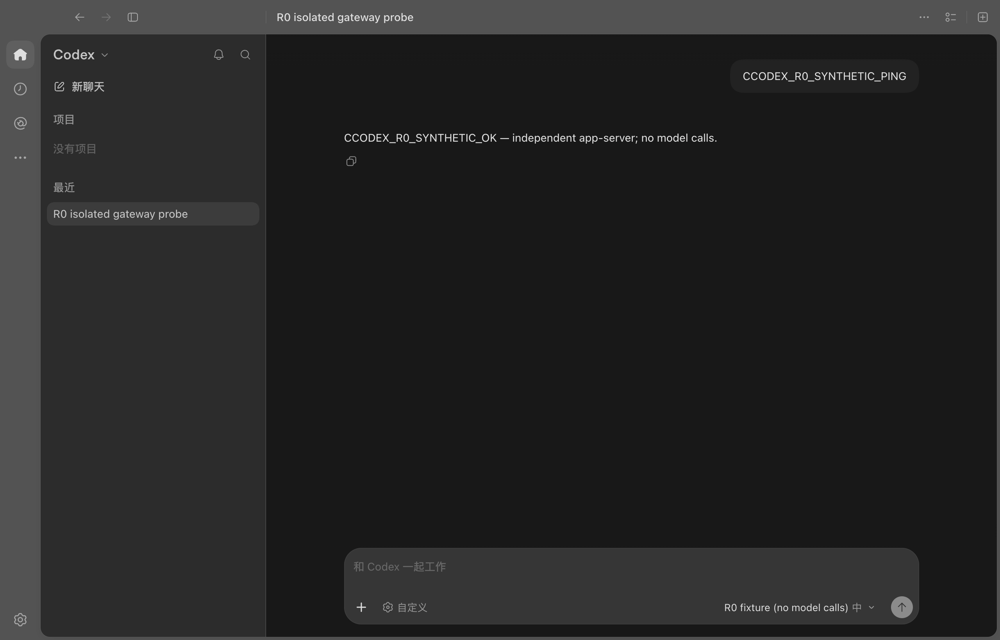

# R0：独立 app-server 接入实测

2026-10-28，macOS ARM64。结论：当前客户端可以通过自有 stdio 入口完成原生聊天显示，不需要 Copilot 模型 API bridge，也不需要由宿主 Codex Agent 转述。这里验证的是确定性协议桩，不是已经可用的 Claude Code / Copilot CLI 网关。

机器可读证据见 [本次报告](evidence/2026-10-28-macos-r0.json)。以下截图来自原生页面；CDP 只操作历史条目、输入框和发送按钮，没有向页面注入回复内容。



## 验证对象与边界

| 项目 | 本次记录 |
|---|---|
| Desktop | `26.1023.50603`，macOS ARM64；应用包名为 `ChatGPT.app`，内部产品元数据为 Codex |
| 随应用附带的 CLI | `codex-cli 0.165.0-alpha.1.2` |
| CLI 相对资源路径 | `codex-cli/CodexCLI.app/Contents/MacOS/codex`；与仓库旧快照假设的 `Resources/codex` 不同 |
| 当前仓库 | `ba2db70` / `VERSION=1.2.36`；本分支没有升级产品版本 |
| 公开协议生成 | 目标 CLI 的 `app-server generate-json-schema --experimental` |
| 完整生成 schema SHA-256 | `8c2a3adebb3e0da97f9b1efaf686f8d14f9969436879ade25a4b1b208ec65cd7` |
| Desktop / CLI 文件摘要 | 记录在证据 JSON；仅对此组合的实测负责 |
| 登录 | `account: null`、`authMethod: null`、`authToken: null`，`requiresOpenaiAuth: false` |
| 模型 | 明确标注 `R0 fixture (no model calls)`，只有一个固定合成响应 |

使用签名应用的临时副本、独立 `CODEX_HOME`、独立 Electron 用户目录和临时工作目录；没有复制用户认证文件、会话或插件配置。原应用进程保持运行。fixture 不启动 CLI 引擎、不调用模型网络服务，也不执行客户端发来的 `process/spawn` 或文件操作。

首次欢迎向导并不完全独立于宿主功能：一轮空配置启动停在欢迎流程。最终验收显式使用 `--skip-welcome`，在新建临时配置中写入该版本的“已跳过欢迎页”偏好。它不改变认证状态，不代表已验证新用户欢迎流程；此偏好是版本相关的内部适配，不应直接作为跨版本产品实现。

## 已跑通的路径

1. 启动预检调用自有 CLI 的 `--print-startup-config`。
2. Desktop 通过 stdio 对 fixture 执行 `initialize`，读取配置、真实的未登录状态及测试模型目录。
3. 原生模型选择器显示测试模型；原生历史列出固定测试会话。
4. 打开会话，完成历史读取与恢复；在原生输入框输入 `CCODEX_R0_SYNTHETIC_PING` 并发送。
5. fixture 收到 `turn/addUserMessage`，返回接纳结果，发出 turn/item/delta/completion 及 idle 通知。
6. 原生页面显示 `CCODEX_R0_SYNTHETIC_OK`。报告同时记录 `syntheticCompletions: 1` 和 `uiTurnVerified: true`。
7. 探针停止自己拥有的进程组及从临时应用派生的 helper，删除应用副本和配置，保留报告、协议形状和截图。

fixture 的固定历史在每个进程内生成，不提供跨连接状态一致性、持久化恢复、模型执行或审批保障。它只适合证明这条接入链路。

## 对架构有影响的发现

**一个 Desktop 实例会启动多个 app-server 进程。** 本次有三个不同进程完成初始化；历史读取和聊天请求出现于不同连接。这个事实要求产品共享会话状态，但并不逻辑上强制采用某一种 daemon 实现。

首版选择以下方式，使运行中的 CLI 会话、审批和落盘由一个实例拥有。另一种方案是多个 app-server 进程共同读写数据库并互相转发活动会话；它仍要解决进程协调，因此本次不选它。也不新增独立 supervisor 或管理 HTTP 服务。

```text
Codex Desktop
  ├─ stdio 前端 A ─┐
  ├─ stdio 前端 B ─┼─ 实例私有 IPC → 单一网关 → Claude / Copilot / 其他 CLI
  └─ stdio 前端 C ─┘

可选 CDP 增强 → 客户端组件及业务函数
```

**公开 schema 不覆盖全部 Desktop 接口。** 本次实际用到的 `getAuthStatus` 和 `turn/addUserMessage` 未出现在该 CLI 生成的公开 schema 中。发送成功不能只靠实现 `turn/start`；历史也不能只靠 `thread/read`。正式实现需要版本化扩展契约，以及接纳去重、排队、恢复、取消等测试。fixture 的 `admissionOutcome: "started"` 只实现固定单轮场景。

**启动参数不能按固定位置解析。** `-c` 参数可以位于 `app-server` 之前；启动预检带有 `--analytics-default-enabled --print-startup-config --startup-client-info`，后续还观察到 `--listen`。探针只记录参数名，不保存参数值。

**CDP 不是协议接入的前提。** 本次没有加载仓库的 `desktop-patch.mjs`，原生模型选择与回复显示直接来自 app-server。探针用 CDP 进行 UI 自动化和截图，产品网关不应导入 CDP。欢迎页、宿主专属菜单及个人组件是独立的客户端适配范围。

## 观察到的接口

下表是本次记录及桩的处理范围，不是声称已经推导出所有版本的最小方法集合。完整方法名和参数键见证据 JSON。

| 范围 | 方法 | 当前验证 |
|---|---|---|
| 连接与账户 | `initialize`、`initialized`、`getAuthStatus`、`account/read` | 明确无宿主认证；未伪造账号或 token |
| 配置与目录 | `config/read`、`configRequirements/read`、`model/list`、`permissionProfile/list` 等 | 测试目录可被原生 UI 消费 |
| 历史 | `thread/list`、`thread/read`、`thread/resume`、`thread/turns/list`、`thread/items/list` | 固定测试会话可打开；缺分页接口时曾导致加载失败 |
| 原生发送 | `turn/addUserMessage` | 固定合成输入与确定性事件完成显示 |
| 其他宿主能力 | `config/batchWrite`、`plugin/installed`、`marketplace/add`、`remoteControl/status/read`、`process/spawn`、`thread/goal/get` 等 | 桩明确报不支持；部分会产生日志错误，不能宣称完整客户端功能可用 |

正式网关应为确有需要的本地设置提供真实、隔离的实现；没有实现的云服务和工具能力不能返回伪造成功，更不能把未知 RPC 全量转发给官方 Agent。

## 如何复现

源码入口：

- [探针](../../tools/probe-desktop-app-server.mjs)：复用现有 Desktop 检查和 CDP 传输，不改生产启动器。
- [协议桩](../../tests/fixtures/desktop-app-server-probe.mjs)：只接受带标记的隔离配置及合成输入。
- [定向测试](../../tests/desktop-app-server-probe-test.mjs)：隔离、监听进程归属、启动参数、无认证语义、历史、事件顺序、扩展接口及错误路径。

先只读检查；`node` 应指向本机可用的 Node 24 运行时：

```sh
node tools/probe-desktop-app-server.mjs --app /Applications/ChatGPT.app
```

显式启动验证实例并执行合成消息：

```sh
node tools/probe-desktop-app-server.mjs \
  --app /Applications/ChatGPT.app \
  --launch-fixture --skip-welcome --exercise-turn --seconds 60
```

这个命令会短暂打开测试窗口，不是隐形测试。`--skip-welcome` 仅允许已验证的 Desktop 版本；其他版本先只读检查。`--exercise-turn` 只操作确认属于探针进程组的本地 CDP 端点，不连接现有用户窗口。CLI 返回报告目录；UI 验证失败返回非零退出码。

本次定向测试 9/9 通过，经仓库 Unix 调度器运行。macOS 没有 `flock` 命令，使用 Python `fcntl.flock` 持有同一全局锁，再通过调度器已有的父调度器标记执行；不是绕过锁。没有运行全量测试或六平台发布。

## 尚未完成

- R1 的正式模式分流、旧入口认证与端口准备解耦。
- 单一私有网关、IPC 前端、持久化和多连接一致性。
- Claude Code、GitHub Copilot CLI 的真实会话、工具、审批、取消及恢复；Gemini 模型目录也未验证。
- 当前工具进程 PATH 及常见安装目录中未发现 `claude`、`copilot`；真实引擎尚未验收。线上复核已确认两套官方 SDK 可携带各自运行时，因此缺全局 CLI 命令不是 R1/R2 的阻塞条件，见下方依赖复核。
- 没有 Windows / Linux 兼容证据。macOS 新 CLI 资源路径尚未接入生产快照检查。
- 本地尚未取得 `pwsh`、发行 manifest、发布准入材料和匹配的平台构建产物；完整发布链还包含 Windows C# 编译器等依赖，仅安装 macOS PowerShell 不能满足。线上已有旧版 Release 可取，但不等于本次修改已通过发布验收；`VERSION` 保持不变。

下一步沿用现有 `bridge/desktop-launch.mjs` 拆出模式准备函数，在所有旧认证与 bridge 准备动作之前分流，再落地实例私有网关。R0 探针继续作为客户端更新后的兼容验收入口。


## 线上依赖复核：2026-10-28

缺口需按阶段区分，不能把发布条件当成继续编写网关的前置条件。

| 项目 | 核查结果 | 对后续工作的影响 |
|---|---|---|
| Node / npm | 本机已有可执行的 Node `24.19.0`；当前 PATH 无 npm，官方 npm 包可获取 | 可补充包管理工具，不需要为了网关先安装 Homebrew |
| Claude Agent SDK | 官方文档确认 TypeScript SDK 通过平台可选依赖携带 Claude Code；npm 当次 `latest` 为 `0.3.312`，含 darwin-arm64 包 | 可以准备 SDK/运行时；真实授权另验，不因缺全局 `claude` 命令暂停开发 |
| GitHub Copilot SDK | 官方文档确认 Node SDK 携带 CLI 运行时；npm 当次 `latest` 为 `1.0.28`，含 darwin-arm64 包 | 通过适配器调用真实 Copilot Agent；不再增加一层宿主 Codex 模型推理 |
| 原生 CLI 安装渠道 | Claude Code 与 Copilot CLI 都有官方原生安装方式；当次 npm 版本分别为 `2.1.312`、`1.0.105` | 若选择复用用户现有 CLI，可配置其绝对路径；不强制全局安装 |
| 原仓库离线资源 | 使用已配置的 Git 凭据成功读取 `VincentVanNF/ccodex-release` 的 `v1.2.36` Release；包含 macOS ARM64 包（345,342,989 字节）、其他平台包和 `SHA256SUMS.txt` | 旧 runtime 有获取来源；尚未下载、校验或证明与本次源码兼容 |
| 运行账户 | Git 仓库读取已可用；尚未验证 Claude 运行授权及 Copilot 模型调用权限 | Git 仓库权限不等于 Copilot Requests 权限；Gemini 必须以目标账号实时模型目录为准 |
| 完整发布 | `Publish-Release.ps1` 还检查历史 manifest、准入证据、Windows C# 编译器及平台资源 | 这是发行验收条件，不阻塞 R1/R2 实现和隔离测试 |

版本号是当次 registry 查询结果，尚不是项目锁定版本。正式加入依赖时应固定 SDK 与匹配运行时，再验证协议、审批、恢复和取消；不能直接照抄主分支文档假定已发布版本拥有相同 API。

Claude 原生 CLI 的订阅登录与 Agent SDK 面向产品的认证要求应分别核对。SDK 官方快速入门使用 API / 云供应商认证，并对第三方产品提供 claude.ai 登录作出限制；不把“SDK 内含 CLI”推导为“任意订阅凭据都可以复用”。当前个人本地 CLI 接入和未来对外发行需保持这个边界。

来源：

- [Claude Agent SDK 安装与运行时](https://code.claude.com/docs/en/agent-sdk/quickstart)
- [Claude Code 原生安装](https://code.claude.com/docs/en/setup)
- [Claude Code 认证](https://code.claude.com/docs/en/authentication)
- [GitHub Copilot SDK](https://github.com/github/copilot-sdk)
- [GitHub Copilot CLI 安装](https://docs.github.com/en/copilot/how-tos/copilot-cli/set-up-copilot-cli/install-copilot-cli)
- [GitHub Copilot CLI 认证](https://docs.github.com/en/copilot/how-tos/copilot-cli/set-up-copilot-cli/authenticate-copilot-cli)
- [私有仓库 v1.2.36 Release](https://github.com/VincentVanNF/ccodex-release/releases/tag/v1.2.36)
- [PowerShell macOS 安装](https://learn.microsoft.com/en-us/powershell/scripting/install/install-powershell-on-macos)
