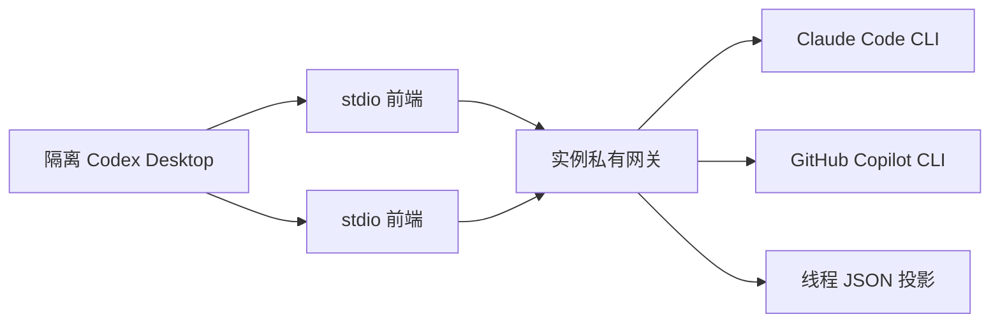

# 独立网关源码与验证记录

2026-10-28，分支 `codex/mycodex-app-server-design`，源码基线 `ba2db70`，发行 `VERSION` 仍为 `1.2.36`。这是开发原型记录，不是安装包发布记录。

2026-10-29 更新：Mac 当前宿主的 `--prepare-only` / `--activate` 代码、独立 CLI 选择器已实现；准备已运行，启用未运行。Copilot 已授权，真实文本/会话恢复/拒绝及批准写入通过；目录暂无 Gemini，Claude 未登录。最新证据和剩余边界见 [ADR 0002](0002-current-chatgpt-host.zh-CN.md#2026-10-29-本机进展)。下列 2026-10-28 探针保留为历史证据。

**用户随后明确：最终要增强当前 ChatGPT，不另开客户端/profile。** 以下隔离启动代码只是开发原型，不能直接作为最终部署路径；当前宿主接入与延后重启约束见 [ADR 0002](0002-current-chatgpt-host.zh-CN.md)。原生通道与第三方通道的路由已进入源码并通过协议测试，尚未接入当前客户端，不能用旧隔离网关替换正在使用的后端。

## 已落地的职责

| 位置 | 当前行为 |
|---|---|
| `bridge/desktop-mode.mjs` | 解析配置与互斥的检查、准备、启用参数；缺省保留旧模式；拒绝未知字段、重复 ID、重叠 profile；实例绑定后不能换模式 |
| `bridge/desktop-current-host.mjs` | 当前宿主检查、准备和显式启用；活动 app 存在时拒绝启用，不进入旧隔离 profile 路径 |
| `bridge/desktop-cli-selector.mjs`、`desktop-gateway-ui.mjs` | 可复用选择器与两个业务函数；独立 helper 负责版本化 CDP 接入及导航，尚未注入当前 app |
| `bridge/desktop-backends/` | 旧模式准备 bridge/profile；网关模式准备 SDK 后端、私有 socket 和 CLI shim，跳过旧账号登录、桥接端口和业务 UI helper |
| `bridge/desktop-launch.mjs` | 继续共用实例锁、快照、进程身份、启动与激活；没有第二个产品启动器 |
| `gateway/stdio.mjs`、`ipc.mjs`、`server.mjs` | 每个 Desktop app-server 子进程使用薄 stdio 前端，连接同实例的一个私有网关；每条连接独立请求 ID 与审批映射 |
| `gateway/routed-stdio.mjs`、`router.mjs`、`native-peer.mjs` | 当前宿主路线的协议前端：原生请求透传，显式第三方模型与已归属第三方线程进入共享网关；尚未启用到 Desktop |
| `gateway/rpc-peer.mjs`、`merged-page.mjs` | 请求与反向审批隔离、模型与历史分页合并；签名游标可跨前端连接恢复 |
| `gateway/protocol.mjs` | 模型目录、会话、文本 turn、两种发送方法、历史投影、取消、审批/提问及基础工具事件映射；未知方法报错 |
| `gateway/state.mjs` | 每个线程一个原子 JSON 文档，单网关写入；先保存执行意图，后调用 CLI；重启后不重发结果未知的任务 |
| `gateway/engines/` | Claude Agent SDK、Copilot SDK 控制其原生 CLI；引擎工厂是固定 Map，没有插件容器或任意 shell 执行接口 |
| 既有开发/打包清单 | 包含 `gateway/` 源码及摘要；不代表 SDK 离线载荷或全平台包已经准备完成 |



网关不导入 `bridge/desktop-*`、CDP、React 或旧模型 API bridge。CDP 负责页面选择器挂载与导航；聊天响应由 app-server 协议进入页面。网关模式不启动原有账号/额度增强；选择器采用注入业务函数，但没有引入通用 DIY 组件框架。

## 当前支持边界

- 产品启动路径仅开放 macOS + Desktop `26.1023.50603`。其他平台或版本明确失败；已有桥接模式保留原平台支持。
- 公共协议基线来自该 Desktop 所带 CLI `0.165.0-alpha.1.2`；另适配实测私有方法 `getAuthStatus`、`turn/addUserMessage`。
- SDK 接口按 `@anthropic-ai/claude-agent-sdk 0.3.312` 和 `@github/copilot-sdk 1.0.28` 编写；实测内置 Claude CLI `2.1.312`，Copilot SDK 声明的 CLI 为 `1.0.105`。
- 只接收文本输入。CLI 工具通过自身权限机制执行，网关没有实现 Codex OS sandbox。计划模式、Codex 权限覆盖、结构化输出及 multi-agent 覆盖会明确拒绝；仅接受 schema 标注已弃用且忽略的 `multiAgentMode=explicitRequestOnly` 默认字段，不把它当成已实施的 CLI 策略。推理强度当前仅暴露 CLI 默认值，尚未支持按模型覆盖。
- 线程保存具体 engine ID、adapter 和 native session ID；默认引擎变化不迁移已有会话。未知引擎不转交宿主 Codex，也不静默重试另一 CLI。
- Gemini 只能来自 Copilot CLI 的实际模型目录。源码不写死 Gemini 版本，也不把能列出模型当成账号已有使用权限。
- CLI 权限请求通过原生 `item/tool/requestUserInput` 展示；默认拒绝，只有明确的 “Allow once” 返回一次性许可。连接断开、超时和无效答复不会批准。真实 Copilot 协议链路的拒绝/批准已通过，当前 ChatGPT 中的展示仍待验证。
- CLI 取消确认前仍显示执行中；真实 Copilot 已通过待审批时取消及 SDK 运行时重建后的恢复。其他中断阶段、孤儿进程异常回收和完整 Desktop 重启恢复仍待验收。
- 当前未覆盖原生终端、文件浏览、fork、压缩、完整插件管理、新建项目向导或全部 app-server 方法。欢迎流程的版本化种子只存在于隔离探针中；不把跳过欢迎的验证称为完整首次安装体验。

## 源码运行（隔离开发入口）

以下命令描述 `host: "isolated"` 开发入口，不是用户当前客户端的启用命令。当前客户端使用 [检查/准备/显式启用](0002-current-chatgpt-host.zh-CN.md#当前宿主的检查准备与启用) 流程。

原有安装包无需修改。使用配置样例前，把 SDK 入口路径换成实际安装位置。SDK 自带 CLI 时无需填写 `executable`；指定原有 CLI 时再填写绝对路径。`sdkPath` 是用户明确选择的本地可执行模块，只使用可信来源。

```sh
node bridge/desktop-launch.mjs \
  --config /absolute/path/config.json \
  --instance agents
```

`--inspect-only` 不创建 profile、不启动服务；未准备快照时会报告快照不存在。首次正常启动可以通过实例的 `desktopApp` 指定 `/Applications/ChatGPT.app`，沿用原快照准备流程。SDK 载荷默认从 `runtime/gateway/node_modules/` 加载；本次只在仓库外的开发缓存安装了依赖，没有把依赖复制进源码或现有安装。

- 不存在默认 `~/.mycodex/config.json` 且未指定配置时，仍使用旧 `.codex-copilot` 行为。
- 显式配置的命名实例默认位于配置目录下的 `instances/<id>`。`legacy` 也表示新的隔离实例，不会因名字相同自动借用旧账户。
- 可为旧模式显式填写 `profile` 指向已有 ccodex profile；隔离网关必须使用独立 profile。当前宿主不允许配置 `profile`，只在独立目录存储网关状态，保留 app 自己的 profile。
- 配置有未知字段立即报错。原设计中的 `extensions` 尚未实现，已从可执行样例移除，不会假装启用了组件。
- 正在运行的实例不热换配置；退出后网关在无连接、无执行任务持续 60 秒时退出，再启动才能应用新配置。旧状态仍保留。
- SDK 使用 CLI 自身认证来源；Git clone 成功不代表 Claude 或 Copilot CLI 已登录。网关不会把 Git 凭据换成模型凭据。

## 验证证据

1. 较早一轮定向测试 60 项：59 项通过，1 项已存在的失败。失败为 `desktop-isolation-test.mjs` 对 `src/CodexCopilotDesktop.cs` 中 `CommandLineToArgvW-compatible` 注释的文本断言；已核对该 C# 文件与 HEAD 完全一致，HEAD 也没有该注释。没有通过删掉断言来隐藏失败。本轮含新增路由和宿主检查的 57 项定向测试通过；该集合不含上述既有失败，不代表全仓测试已全绿。
2. 本轮模块检查：131 个 ESM 模块、256 个相对 import；先前 release/developer 入口语法检查通过。
3. 共享网关协议测试：两连接使用相同请求 ID；同线程并发只接纳一个 turn；断线审批拒绝；中断等待；未知能力无 CLI 副作用；第二网关不能取得同一 socket；执行中恢复不自动重发。
4. 真实隔离 Desktop：协议原型曾通过三个初始化连接、一次原生发送和确定性回复显示，无模型调用。之后补充严格参数拒绝时发现 Desktop 默认还携带 `multiAgentMode`，最近一次 UI 探针未通过。本轮已修正该默认字段的协议处理并通过回归测试，尚未复验 UI；不能沿用旧截图宣称当前版本页面通过。见 `evidence/2026-10-28-shared-gateway.json` 和对应记录。
5. 正式 gateway backend 的启动/复用检查通过：使用已安装官方 SDK，私有进程和 IPC 身份可校验；没有启动 bridge。检查结束后已退出自建网关并清理临时 profile。
6. 2026-10-28 授权检查：两个 CLI 当时均未登录，无真实推理。2026-10-29 用户完成 Copilot 设备授权后已真实联调；Claude 仍未登录，不能继续沿用“两个均未登录”的旧状态。
7. 安装版原生 CLI + 新增路由的临时 profile 对照检查通过，无 Desktop 启动、无真实推理。原生历史列表为空；真实用户历史和页面选择器仍待验证。详情和证据见 [ADR 0002](0002-current-chatgpt-host.zh-CN.md#本轮源码与验证)。

共享网关探针复现（仍需经过仓库任务调度器）：

```sh
node tools/probe-desktop-app-server.mjs \
  --app /Applications/ChatGPT.app --launch-fixture --gateway-fixture \
  --skip-welcome --exercise-turn --seconds 50 --output-parent /tmp
```

探针退出后只保留报告、形状记录、日志和截图；删除自己的 app 副本、profile 与连接密钥，不停止原 Desktop。

## 后续 macOS 本机验收

Copilot 的文本、受控文件修改、审批拒绝、待审批时取消及 SDK 运行时重建后的会话恢复已通过；继续验证用户提问、其他中断阶段和真正的当前 Desktop 流程，再完成 Claude 授权与联调。Copilot 目录尚无 Gemini，不能把其他模型的通过当成 Gemini 验收。

R4 已用新选择器验证业务函数与页面分离，原有账户组件尚未迁移；不额外建立 `mycodex/` 包。当前仍需在统一重启后验收原窗口的接入、选择器、停用及更新兼容性。SDK/CLI 的实际运行依赖仍须可用，但不要求先取得原仓库完整离线发行包。

2026-10-29 范围纠正：此前把根目录 `AGENTS.md` 的全平台发行要求当作本轮 Mac 本机交付前提，这是不恰当的阻塞项。按用户明确要求，本轮不依赖 PowerShell、Windows runner、Windows C# 编译器、六平台匹配候选或旧版 Release manifest，使用 macOS 原生运行与验证流程继续实施。

原仓库的正式发行流程仍保留，尚未发布也仍是事实，但不阻塞本轮本机开发和验收。只有后续明确开展正式跨平台发行时，才检查其环境与发行产物；不能用本地测试替代正式发行证据，也不能反过来要求先完成正式发行才能验证本机功能。
