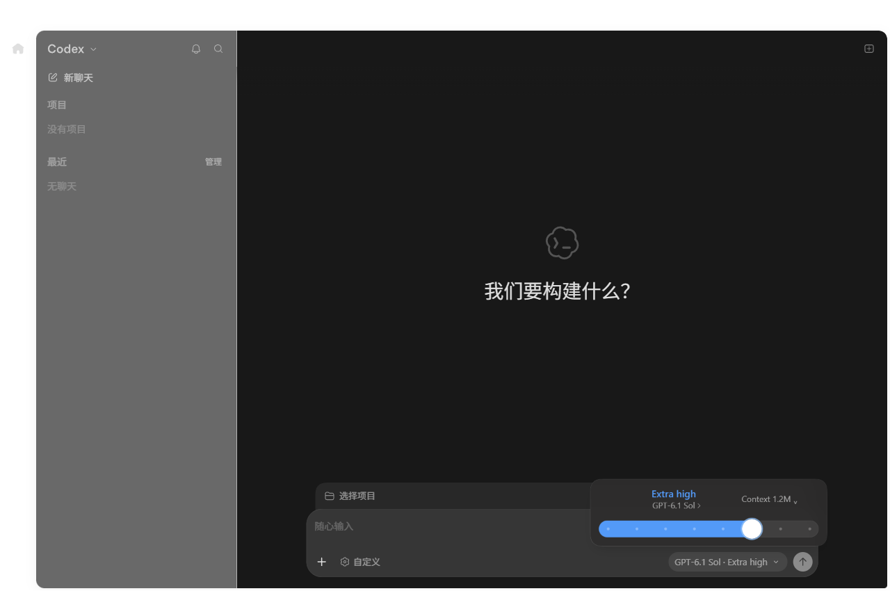

# Desktop 界面修复验收

本轮保持 **Ccodex 1.2.35 / Desktop 26.928.3736.0**，覆盖原 Release 的同名 ARM64 与 X64 安装包。
下载地址和标签不变，已保存的旧 EXE 不会自行变成新包，请重新下载并核对 [当前 SHA256](SHA256SUMS.txt)。
机器可读的安装包摘要、内容槽、回归计数和真实 GUI 结果见 [UI-VALIDATION.json](UI-VALIDATION.json)。

## 修复内容

- 左侧“最近”标题旁显示“管理”，支持中文、英文和空历史；不依赖只在部分状态出现的原生选项按钮。
- 底部按钮显示实际提交的模型及 Effort，不再保留“选择强度”占位文字。
- 原生弹窗中的模型标题可换行，Context 控件与模型标题分开布局，避免模型名被截断或覆盖。
- 保留原生强度滑块、动画和回调；切换 Context 或 Effort 不用替代控件，也不应重置另一个选项。
- Windows 私有文档运行时切换对临时占用进行最多 30 秒重试；持续失败会停止并尝试恢复旧资源，不改变权限、不结束未知进程。
- 安装/离线诊断的完整文档检查使用 240 秒外层预算，覆盖渲染与 120 秒 Python 子检查；分阶段记录进度，日常启动路径不执行这项重检查。
- Work IQ 说明移除真实企业环境验证叙述，只保留通用接入、同意、审批和合成验证方法；接入代码、凭据规则与授权默认值不变。

## 实测内容

两种架构各有 **412 项相关回归通过，失败、取消和跳过均为 0**。
真实安装的 Desktop 使用独立测试 profile、合成账户、合成模型元数据和本地上游服务：

- 空历史下“管理”可见；打开后完成真正的本地会话后端查询，不把错误后的空列表算作通过。
- 底部模型摘要对应提交状态，不显示强度占位文字。
- 实际原生弹窗的模型标题没有截断，与 Context 没有重叠，原生强度滑块仍在。
- Context 切换由原生回调确认；原生滑块改变 Effort 后，模型和长 Context 均保持不变。
- GUI 入口未显示终端窗口；没有发送推理请求，没有读取发布者的 profile。
- 最终 EXE 摘要绑定完整压缩载荷校验及同版本隔离重装；版本选择、profile 准备和启动资源校验均由实际安装器执行。

以下截图来自独立合成测试，不包含真实企业数据：

### X64

### ARM64

## 验证边界

宿主为 Windows 11 ARM64；ARM64 原生验证，X64 使用仿真，不代替物理 X64 主机验收。
模型名称与 1.2M 数值是测试元数据，不能证明任何真实账户已获得相应模型或上下文额度。
真实 GitHub 首次授权、付费推理、全部企业及 Computer Use 能力没有在本轮重新验证。

隔离安装先准备可确认归属的资源槽，最终 EXE 执行原生引导、完整归档解压、
全部资源重校验及自有 profile 重装；完整新机器复制路径沿用未修改安装器的历史验证，
本轮没有把资源槽复用称作另一台干净机器的首次安装。

此前启动耗时及旧包摘要是历史基线，见同目录的旧报告；不是本轮替换包重新计时的结果。
程序与本地状态隔离不等于虚拟机隔离；共享项目、系统网络、同一云端账户的权益仍可能影响两边。
安装器无组织代码签名；团队再分发与终端准入应由团队审核。
